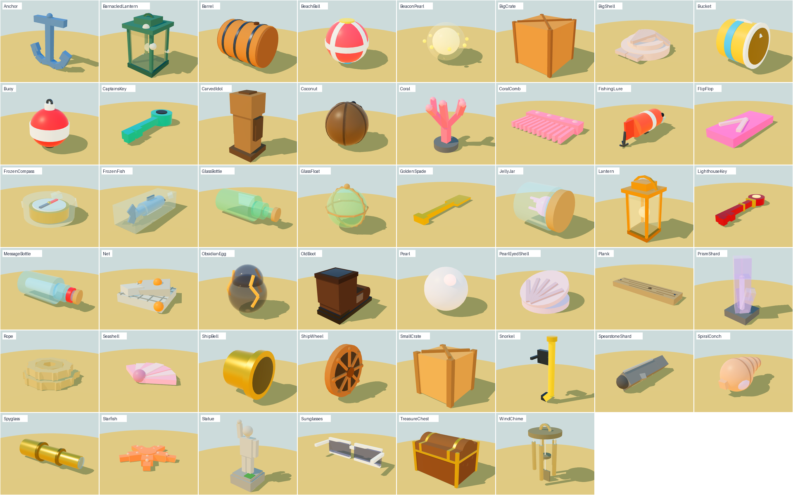
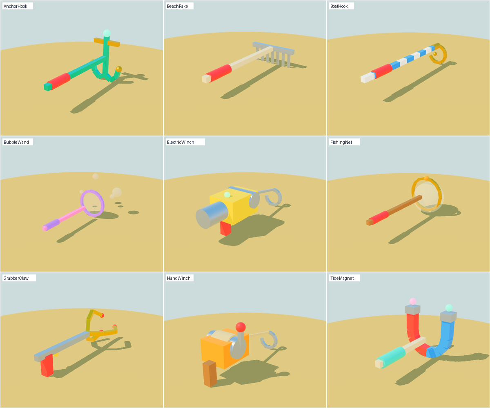
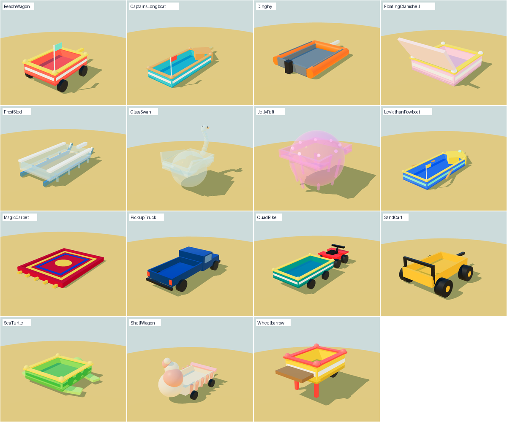
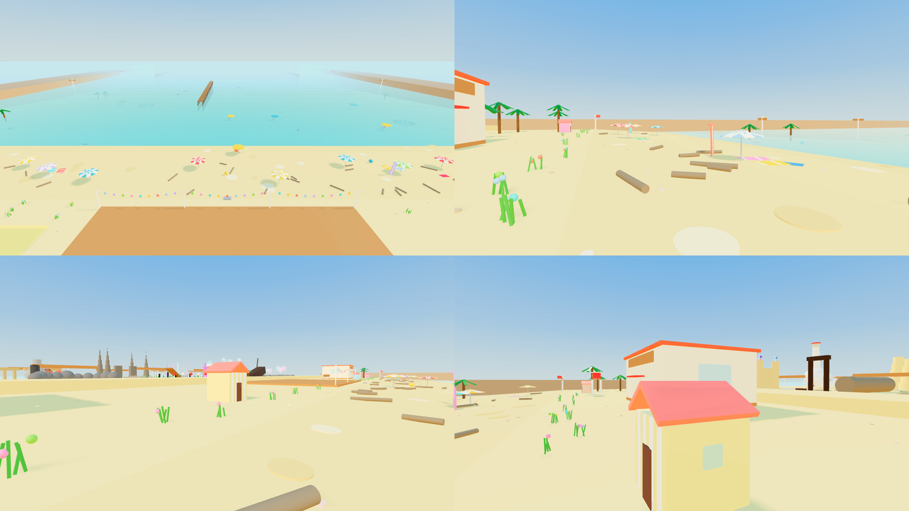

# Salvage Simulator 3

A physics-based Roblox game: drag items out of the tide, sell them, buy better gear.
This repo is the **Milestone 1 test build** from the design doc: the core loop only.

## Running it

The code is a [Rojo](https://rojo.space) project. The tool versions are pinned in `rokit.toml`.

```sh
rokit install          # installs rojo, selene, stylua
rojo serve             # then connect from the Rojo plugin in Studio
# or
rojo build -o SalvageSimulator3.rbxlx   # and open the file in Studio
```

The map is built from code at server start, so any empty place or Baseplate works (the
baseplate is removed). For saving to work in Studio, turn on **Game Settings → Security →
Enable Studio Access to API Services**. Without it, the game still runs but nothing is saved.
Set **Max Players to 20** in Game Settings: each player gets one vessel collision group.

Test with **Test → Clients and Servers** (2 or more players) to check bumping and ownership.

## Checks

Run `bash tools/check.sh` before pushing. It checks:

1. **Formatting:** StyLua formatting.
2. **Lint:** selene lint.
3. **Roblox API names:** `tools/check_api.py` checks every `Enum.X.Y`, class name, service and instance property against Roblox's real API. The API comes from the `@rbxts/types` npm package, downloaded once into `tools/.cache`.
4. **Lune tests:** `tools/tests/run.luau` uses [Lune](https://lune-org.github.io), which ships Roblox's API database. It loads every module the way Roblox does, runs the data validator, and builds every item, vessel, biome (decor, entrance, hazard), secret course and the beach with real instances. A wrong property, Enum item or value type (such as `nil` where a colour is needed) fails here, just as it would in Studio.
5. **Rojo build:** `rojo build` succeeds.

Two more safeguards live in the game itself:

- **Palette:** `src/shared/Palette.luau` holds every shared colour, material and font by name. Code uses `Palette.UI.Accent` or `Palette.Material.Wood`, never inline values, so one look changes in one place.
- **Data validator:** `src/shared/Validate.luau` checks that the data fits together when the server starts. For example: every secret has a coin *or* a loot table, every loot item exists, every rarity has a colour, and every ownable vessel has a builder. Problems print to Output as `[Validate]` warnings.


**The Test Range** (`tools/range`, see its README): checks a zone of the beach inside the real Roblox engine, through Open Cloud, without Studio: props floating, buried or inside rock, terrain and walls against their layouts, creatures' routes, Roblox pathfinding across the zone against its target time, and the water at several tide levels. `python3 tools/range/run.py --zone 4 --all HermitHollows`.

## The look: models, paint and scenery

Everything you see is built from parts in code (no uploaded meshes or textures), so the surface
detail comes from Roblox's own materials (`WoodPlanks`, `Metal`, `Foil`, `Glass`, `Neon`, `Fabric`).
Each piece is a welded model on top of the thing it decorates: its parts weigh nothing and never
collide or get picked, so physics, grabbing and cargo behave exactly as before. The shared
helpers are in `src/server/ModelParts.luau`; colours are in `Palette.luau` (`ItemModel`,
`ToolModel`, `VesselTrim`, `Cheer`).

| What | Where |
| --- | --- |
| Beach items (19). The catalog part stays the invisible physics body | `src/server/ItemModels.luau` |
| Tools in the hand (all but Bare Hands), attached at `RightGripAttachment` | `src/server/ToolModels.luau` |
| Vessel paint and trim (stripes, rim, bumpers, pennants) | `src/server/VesselTrim.luau` |
| Beach scenery: striped umbrellas, towels, huts, bunting, surfboards, flowers | `src/server/BeachCheer.luau` |
| Late-afternoon light, a clear sky with clouds, bright haze | `BeachBuilder.setLighting`, `Config.Beach.Fog` |






**Previewing without Studio.** `tools/preview/dump.luau` runs the real builders in Lune and writes every
part (shape, size, transform, colour, material) to JSON, and `tools/preview/render.cjs` draws that with
three.js in a headless browser. It is for judging shape, colour and proportion; it approximates Roblox's
materials and lighting, so check the real thing in Studio.

```sh
lune run tools/preview/dump.luau /tmp/out
(cd tools/preview && npm install)
node tools/preview/render.cjs /tmp/out /tmp/png            # needs `playwright` and a Chromium
```

## What's in Milestone 1

| Doc item | Where |
| --- | --- |
| Custom waves | `src/shared/Waves.luau` is a deterministic force field from the shared clock. The server pushes loose items (`ItemService`); each client pushes its own character, held item and vessel (`WaveController`). |
| Grabbing | `GrabController` (client) and `GrabService` (server). Items are claimed when grabbed, get physics, are network-owned by the holder, become *Loose* when put down, freeze and turn *Unclaimed* after 25 s, then despawn. |
| Assist grab | Tap an item to lift it, then tap your vessel (or press **To vessel**). This works on every platform. On touch screens, a lifted item is only dropped with the **Drop** button, so panning the camera never drops it. |
| Vessels | `VesselService`: Wheelbarrow (one wheel, tips easily) and Beach Wagon (4 wheels). Wheels are visual; vessels slide on hidden low-friction ball skids. Tow them by the handle. Loaded items are welded into slots, so a vessel always holds its full capacity; they only spill if it tips over. Your client keeps your vessel upright (less so for the wheelbarrow) and parks it when you let go. Other players can't touch the vessel or what's in it (collision groups). A vessel covered by deep water is lost with everything in it, and you can spawn it again for free from your inventory, in front of you, anywhere except deep water or a secret. |
| Shop and selling | `ShopService`: shopkeeper prompt, fixed prices, Bare Hands → Grabber Claw (plus Boat Hook, so Heavy items can be tested). Drop items, or park your vessel, on the yellow sell pad, then talk to the **buyer** beside it to sell them. Nothing sells on its own. Your pockets sell when you talk to the buyer, from anywhere. |
| Items | `src/shared/Items.luau` has 14 placeholder items across Light, Medium and Heavy, with each zone's value multiplier applied. |
| Tide | `src/shared/Tide.luau`: the sea level falls, uncovering the outer zones, holds at low tide, then rises again. The cycle is shortened ×0.4 (10 min) for testing. The sea surface and the foam line at the waterline are drawn on each client from the shared clock. There's a warning when the tide turns each way and no on-screen clock; Studio shows a debug readout in the bottom-right. |
| Drowning | `DrowningService`: you lose breath in water deeper than waist height, which moves in and out with the tide, and then take damage. What you were carrying drops when you die. |
| Saving | `DataService`: coins and gear are saved with UpdateAsync and a session lock, with retries, on PlayerRemoving, BindToClose and every 2 minutes. |

## What's in Milestone 2

| Doc item | Where |
| --- | --- |
| Biomes | `BiomeService` rolls each zone every tide cycle (test build: Sandcastle Flats or nothing, `Config.Biomes.RollChance`). A biome zone gets sandcastle decor, mostly its own loot (`Biomes.luau`), and the giant sandcastle with the secret's door. |
| Unlock item | The Golden Spade sometimes washes up in a Sandcastle Flats zone (`Config.Unlocks`). It glows, can be bumped and lost like any item, and is only safe once dropped on the purple floor inside the **bank house** and banked by talking to the **banker**. It is never sold. |
| Secret course | Use a banked spade at the sandcastle door (always used up). You go to your own copy of the Sandcastle Vault, built only on your client (`SecretController`, layout in `Secrets.luau`): a spiral climb while the sea floods in. The flood time depends on when the real tide would cover the door. `SecretService` verifies the run from your position (checkpoints in order, above the water, plausible time, at the chest) before granting the yellow coin. |
| Rebirth | In the shop: costs 100,000 coins, ×1.5 more each time. Resets coins, tools and shop vessels, adds ×0.5 coin multiplier. At each rebirth you pick one of the 8 rewards you don't have yet (see **Rebirth rewards** below). |

## True rebirth, attunement and exotic secrets

| Doc item | Where |
| --- | --- |
| Rare biome | **Shipwreck Shallows** (Uncommon tier) rolls by weight with the others (its `Zones` weights in `Biomes.luau`) and is never announced. It has wreck debris, ship loot, and its hazard: barrels roll down the sand every 6 s (a Roller hazard), and a hit knocks what you hold out of your hands. |
| Exotic unlock item | The **Captain's Key** washes up in Shipwreck Shallows, much more rarely than common unlock items (`Config.Unlocks.ExoticSpawnChance`). It is banked like the Golden Spade. |
| Exotic secret | The **Sunken Hold**: use a banked key at the wreck's hatch. It's a zig-zag climb up a hull while it floods, and it can be repeated. It ends in a **lootbox** (`Secrets.luau`) rolling the Anchor Hook (grabber), Captain's Longboat (vessel, holds 12) or Deckhand's Satchel (accessory, +3 pocket slots), with a 1.5% chance of the **Barnacled** cosmetic variant. Rewards go straight to the inventory. |
| True rebirth | In the shop: redeem all 5 colored coins (two clicks). It resets coins, gear, rebirths, multiplier, rewards, magical vessels, colored coins and pockets. It keeps unlock items, exotic items, cores and attunements, and gives **1 attunement core**. |
| Attunement | Exotic items can't be used until you spend a core on them (**Attune** on the inventory card). Attunement is to the item type, so trading the copy away and getting another later still works. |

## Biomes and their hazards

Every tile of the beach rolls a biome each tide cycle, from those that can turn up in its zone (`Biomes.List[id].Zones`, against `Config.Biomes.NoneWeight`). A biome is data:

- **Where it rolls:** `Zones = { [zone] = weight }`. Rarer biomes roll further out.
- **Its ground:** its layout (`src/shared/Layouts/Biomes/<Id>`), which can also place its hazards, its loot spots and its entrance.
- **Its hazards:** a list of entries of a few generic kinds (`src/shared/Hazards.luau`), each with its own settings:
  - **Roller:** something rolls down the tile on a timer (the Shipwreck barrels).
  - **Patrol:** creatures walk a route back and forth, or wander (the Hermit Hollows crabs).
  - **Pulse:** a spot erupts on a timer after a warning glow (vents, blowholes).
  - **Slow:** patches that slow you while you're in them (sea glass, seagrass).
- **What a hazard does** is its effect: **Knockdown** (you're knocked over and drop what you hold), **Drop** (it's knocked out of your hands) or **Slow**. The server builds and moves the hazards (`HazardService`); your own client checks your character against them and applies the effect (`HazardController`), like the waves.
- **Its secret:** a biome without a `Secret` has no entrance yet (and doesn't wash up its unlock item).
- **Its scenery:** a decor builder (`Scenery`), or low mounds in its colour.

Biomes so far: Sandcastle Flats (zones 1-4), Shipwreck Shallows (zones 2-6, barrels) and **Hermit Hollows** (zones 4-6: a maze of rock corridors patrolled by hermit crabs that knock you flat; no secret yet). Admins can set a tile's biome with `biome <tile> <name>`.

## Lexicon and the tower man

- **Recording:** the first time you grab an item type off the beach, it's recorded in your lexicon for good (`DataService.recordLexicon`), with a "New lexicon entry" message.
- **Viewing it:** the inventory's **Lexicon** tab shows every item, with undiscovered ones as "???".
- **The tower man:** each tide cycle, every zone has a 0.1% chance (`Config.Lexicon`) of a man appearing on top of a tall dirt tower with ledges to climb (`LexiconService`).
- **The hat:** with a complete lexicon, talking to him gives you the **Tall Top Hat**. It's untradeable, never lost, and worn or taken off from the inventory.

## Special traders

All six from the design doc are defined in `src/shared/Traders.luau`.

- **Who can appear:** only Gary (Sandcastle Flats) and Rusty (Shipwreck Shallows) for now, because the other traders' biomes don't exist yet.
- **When:** if their biome rolls, they appear 50% of the time in common biomes and 25% in rare ones (`Config.Traders`).
- **Buying:** each appearance sells at most one level. A level costs coins plus 3/6/10 of the biome's item, which you bring. Items count if they're near the trader, in your vessel, held, or in your pockets. Madame Gull takes 1/2/3 attunement cores instead.
- **Resets:** upgrades are kept through normal rebirths and lost on a true rebirth, except Madame Gull's Tide Reading.

| Upgrade | Effect (per level) | Where |
| --- | --- | --- |
| Comfy Sandals | +5% walk speed | `RebirthService.applyEffects` |
| Tight Knots | items 15% harder to knock loose | `GrabController` grip |
| Deep Lungs | +20% breath | `DrowningService` |
| Tide Reading | rare-biome hints when you join and each tide | `TraderService` |
| Barnacle Boots | waves push 10% less, never below 30% | `WaveController` |
| Frostrunner Wax | +20% vessel speed | `GrabController` towing and hover |

## The tide and the waves

All of this is computed from the shared clock, so the server and every client agree without sending anything per frame. Every number is in `Config.Tide`, `Config.Waves` and `Config.Beach.Pools`.

**How the tide goes up and down:** `OutShape` and `InShape` are lists of how far out the tide is (0 = high, 1 = low) at evenly spaced moments through that phase. The tide follows a smooth curve through them. Repeat a value to make it pause, or bunch values to make it rush.

**Which part goes down when:** `Sections` are points along the shoreline, each with a delay in seconds. That part of the sea follows the tide this much later: positive drains later and floods later, negative goes first. Between points the delay blends smoothly, so the waterline curves along the beach instead of being a straight line. By default the west end drains first and the east end holds water longest. Each delay must stay shorter than the low-tide hold, which the validator checks.

**Random patterns (the sea seed):** each server picks a random sea seed at startup, so no two servers' seas behave the same.
- **Waterline:** a smooth random pattern on top of the sections makes some stretches drain up to 25 seconds earlier or later (`Config.Tide.Shuffle`). The pattern slowly turns into a different one over a couple of minutes, so where the waterline is furthest out and furthest in moves about as the tide goes down.
- **Waves:** each wave has its own front shape (`WobbleAmplitude`) and is up to 35% bigger or smaller at different spots along the beach (`AlongVariation`). The seed also decides which waves are rogue waves.
- **Admin:** `waves seed` picks a new seed, and `waves seed <n>` sets one, to replay a pattern.
- **Validator:** it checks that a section's delay plus the shuffle stays shorter than the low-tide hold.

**The beach's shape** (`src/shared/Layouts`, `TerrainBuilder`): the beach and seabed are smooth Terrain: the even slope plus a hand-built layout for each zone.
- **Layouts:** each zone has a base layout (`Layouts/Zones/ZoneN`). A biome can bring its own (`Layouts/Biomes/<BiomeId>`), which replaces the base layout while it's rolled there; the zone's terrain is rebuilt and `GroundShift` moves props, items and players to stay on the new ground.
  - A layout is a list of shapes: Ridge, Mound, Wall, Channel, Hollow, Ramp and Flat (see `Layouts/init.luau`). Rock shapes are built from rock.
  - **Walls** are rock with a flat top and sides too steep to climb, up to 24 studs tall: well over a jump, and you can't see over them. They're how a maze or a cave passage is made (zone 4 and out). Smooth terrain roughens their sides into something you could scramble up, so each wall has an invisible solid slab down its middle, rising 9 studs over its top (`WallBarriers`); it stops where a ramp or flat cuts through the wall.
- **Roofs** are slabs of rock overhead, on a path (a tunnel) or a round area (a cave chamber), a set `Clearance` over the slope and `Thickness` thick; walls under them make the sides. The ground under a roof is still the floor: water, waves, wading and items all go by it, so caves flood with the tide. Anything that looks down for the ground (water visuals, held items, dropped items, calling a vessel) starts under the roof (`Beach.rayFrom`).
- **Climbing:** nobody can walk up a slope steeper than `Config.Beach.Terrain.FootSlope` (about 42°), the same limit the layout tests use for routes on foot, so steep banks, walls and cliffs have to be gone around.
  - The current base layouts are placeholders; the hand-built ones follow `docs/layout-prompt.md`.
- **Carts:** a towed vessel can't go up ground steeper than `Config.Beach.Terrain.CartSlope`. Every zone has Ramps that cross its edges at x = -200 and x = 180, so a cart can always get down to the sea.
- **The shop and the sandbar** stay flat.
- **Water:**
  - Dips below the sea level flood before the main waterline reaches them, so low ground behind you can fill as the tide comes in.
  - Run-ups stop against ridges unless a wave climbs over them, and ridges standing out of the water shelter the sea behind them.
- **Placement:** everything placed on the beach uses `Beach.groundAt(x, z)`, the slope plus this shape. That includes items, props, cosmetics, biome decor and traders.

**Sea mist** (`Config.Mist`, `MistController`): the haze thickens the further out you are. It's a light haze at the shop and thick on the sandbar, and it blends across zone edges. The Lantern of Clear Sight thins it.

**Things the water reacts to** (`WaterObstacles`, `Config.Water`): tag a part `WaterObstacle` and give it a `Water` attribute (or call `WaterObstacles.mark(part, kind)` from code).
- **`Solid`** (the default): the water can't pass through it.
  - **Run-up:** the run-up stops against it unless the wave climbs higher than its top, so a big wave overtops a low sandbank and a small one stops at it.
  - **Shelter:** out in the sea, waves are sheltered behind it, within 40 studs, wherever it stands out of the water. They push at 15% there, and their crests vanish.
- **`Under`**: the water runs underneath it (a pier deck, an arch).
- **Shape:** its top comes from the part's shape. A block has a flat top, a cylinder lying along X is a ridge (like the sandbanks), and a ball is a dome (like a boulder). Parts may be turned about the vertical axis.
- **Already set up:** the sandbanks, the rock clusters and the beached wreck are solid; the pier deck is `Under`.
- **Everything agrees:** the pushes on players and items, the swash dragging items, and the sea visuals all use the same lookup.

**Rock pools** (`Config.Beach.Pools`): rings of rock that hold still water at a fixed level after the sea leaves. Floating items float in them. They never count as deep water.

**Waves:** each wave rolls in to the local waterline, runs up the exposed sand as a thin sheet, slows to a stop and slides back.
- **Sizes:** each wave's size varies a little. Every 6th wave is a big one, about 3% are rogue waves, and waves get bigger further out (`ZoneScale`, 1.7x on the Far Sandbar). Size scales how far a wave runs up and how hard it pushes. `waves <n>` still scales all of it.
- **The ordinary sea is impartial:** it jostles you back and forth but doesn't pull you out.
  - As each wave approaches, the water rushes out to meet it (the drawback).
  - As the wave passes over you, its front surges you toward shore (`Push`, `BandWidth`), and the water rocks you in and out (`Rock`).
  - For a normal wave this nets out to a gentle drift toward the beach.
  - Between waves the water is still (`Slack` 0), apart from a side-to-side sway (`Sway`).
  - You pick up the water's speed gradually and keep it for a moment (`Coupling`), so it has momentum.
- **Big waves are the danger:** the drawback grows with the wave's size *squared* (`Drawback`). Normal waves barely tug, set waves (every 6th) pull hard, and rogue waves pull very hard.
- **Run-up and backwash:** on the sand, the run-up pushes players, held items, vessels and dropped loot up the beach (`RunUpPush` 12), then the backwash pulls them back (`BackwashPull` 16), both scaled by the wave's size.
- **Knockdowns:** a push of 28 studs/s or more, after Sea Legs or other wave resistance, knocks you over. Normal waves stay under that near the shore. Set waves get there in knee-deep water, rogue waves almost anywhere, and most waves do on the Far Sandbar. The wave tumbles you and carries you out to sea for 1.6 seconds, and you drop what you're holding. A set wave carries you about 30 studs. A rogue wave can carry you about 60 studs, into water deep enough to drown, so being close to the water is a risk you take for better loot.
- **Unclaimed items:** after each wave, unclaimed items it reached may be shuffled a few studs: either way for ordinary waves, mostly out to sea for big ones (`DragChance`, `DragDistance`, in `SurfService`). Anything dragged deep enough is lost.
- **Rogue waves:** clients know they're coming and show a warning banner about 8 seconds before. `waves rogue` sends one.

**Wading:** water is sluggish. Walk speed and jump drop with depth (`Config.Beach.Wading`): 85% in the shallows, 70% knee-deep, 55% waist-deep and 40% once you're fully underwater, blended smoothly in between. Your own client applies it to the speed the server gives you (rewards, trader upgrades, the admin `speed` command).

**What you see** (`SeaController`, client only):
- Each part of the water is one continuous surface (an EditableMesh) whose points move every frame, so the waterline, the foam and the crests are smooth curves that follow the ground. The water is worked out every 12 studs along the shore and drawn every 6.
  - Editable meshes must be allowed for the experience (Game Settings > Security > Enable Mesh / Image APIs). Without them, or on a device out of memory for them, the same columns are drawn with narrow parts instead, and the sea still ends at the same smooth shoreline. The output says which one it used (`[Sea] ...`).
- The sea surface, at the local water level along the beach. Its edge is where the ground really rises out of the water (`Beach.shoreFrom`), which a bank or channel can move out or in; the waves break and run up from there.
- White crests rolling in. They taper off where something shelters the water.
- The run-up sheet with a foam edge, drawn only on the sand. Once the water is back at the waterline it's just the sea.
- Darker wet sand where the tide was in the last 40 seconds, or where the last wave reached.

## The sky-beam item

The **Beacon Pearl** is the rarest unlock item. Your doc doesn't name it, so the name is a placeholder.

- **Spawning:** it only washes up on the Far Sandbar, at a 0.05% chance per surf spawn there (`Config.SkyBeam`), and only one at a time.
- **The beam:** every client draws a tall beam of light over it (`SkyBeamController`). The beam follows the pearl wherever it goes (in the surf, in someone's hands, in a vessel) until it's banked.
- **Announcements:** the server tells everyone when it washes up, who picks it up, and when it's banked or lost (`SkyBeamService`).
- **What it opens:** the Sunken Bell Tower on the Far Sandbar (below).

## The Far Sandbar and the Sunken Bell Tower

- **The sandbar:** zone 7, past the other zones (Z 3688 to 3808), with x25 values. A deep channel (Z 3648 to 3688) cuts it off. You can only cross the channel around low tide, when the waterline reaches Z 3748 (`Config.Beach.FarSandbar`, `Config.Tide.LowWaterline`).
- **The bell tower:** its top sticks out of the sand at Z 680 (`FarSandbarService`). The door is only above water for a short window around low tide.
- **The secret:** bank a Beacon Pearl, then use it at the door. It's an exotic secret, so the climb ends in a lootbox: the **Leviathan Rowboat** (exotic vessel, holds 20) or the **Tide Crown** (exotic accessory, waves push you 25% less). There's a 1.5% chance of the Gilded variant. The climb is the longest of the three, 20 ledges around the tower walls. It floods over a fixed 150 seconds instead of following the tide, because the door is always about to go under when you enter.
- **Admin:** `tp sandbar` puts you in front of the door, and `give beaconpearl` gives you the key.

## Rebirth rewards

All 8 are in. Each rebirth lets you pick one you don't have yet. They stay through normal rebirths and are cleared by a true rebirth.

| Reward | Effect |
|---|---|
| Swift Feet | +20% walk speed and faster vessel towing |
| Sea Legs | Waves push you 40% less, and your breath lasts twice as long |
| Strong Back | Every grabber lifts one weight class heavier, up to Very heavy |
| Deep Pockets | 3 pocket slots for Light items (press **Q** or **Pocket**). They sell to the buyer |
| Tide Magnet | A magical grabber. It reels whatever it holds toward you while that item is in the water, and waves push it half as hard |
| Bubble Wand | A magical grabber. It lifts anything, reaches into deep water and floats items to you slowly in a bubble. Waves can't push or knock it loose |
| Floating Clamshell | A magical vessel. It hovers behind you, carries 8 and never tips. It's lost if it's covered by water |
| Sea Turtle | A magical vessel. It carries 6 and swims at the surface, so deep water doesn't take it, but waves can wash cargo off. It's slow on dry sand |

Walk speed, breath, wave push and lift all come from `Stats.luau`, so rewards, trader upgrades and accessories stack the same way everywhere. The 30% minimum wave push applies once, to the total.

## Paid features

Nothing can be bought until you create the products on Roblox:

1. Publish the game. Then, in the [Creator Hub](https://create.roblox.com/dashboard/creations), open the experience and go to **Monetization**.
2. Under **Developer Products**, create one product for each coin pack. Under **Passes**, create one pass for each gamepass.
3. Paste each id into `Config.Monetization` (`ProductId` / `PassId`). Anything left at `0` shows as "Not set up" in the shop.
4. Private servers: under **Access**, turn on private servers and set a price.

- **Coin packs** (developer products, buy any number of times): 5,000, 30,000 and 150,000 coins. Each purchase is granted exactly once. Its id is saved on the profile before Roblox is told it went through, so a retry, a crash or a second server can't grant it twice or lose it (`MonetizationService`).
- **Gamepasses**, two examples of the two kinds of effect: **Merchant's Scale** (+25% on everything you sell) and **Extra Pockets** (+2 pocket slots, even without Deep Pockets). Add more in `Config.Monetization.Gamepasses` with `SellMultiplier` or `PocketSlots`.
- **Private servers:** rare spawns scale with the player count, reaching normal at 20 players. This covers Rare and Very Rare items (the difference becomes Common), unlock items and the Beacon Pearl. Public servers are always at full rates.
- **Shop:** a **Robux** section lists the packs and passes with their Robux prices.
- **Testing:** in Studio, test purchases are free. `pass <id> on` turns a pass's effect on without buying it, and `private <n>` makes the server act like a private server with n players.

## The global auction

Press **U** (or the **Auction** button).

- **Lots:** one lot at a time, the same on every server, on a fixed schedule (`Config.Auction`: 10-minute lots for testing). Each lot is a scarce cosmetic: the one-of-a-kind **Crown of Tides**, or numbered **Captain's Tricorns** (50) and **Sea-Glass Circlets** (25).
- **Bidding:** bids are held in escrow. Your coins leave your save when you bid, and raising a bid only takes the difference.
- **When a lot ends:** exactly one server resolves it. The winner gets the item with its serial number ("#3 of 50") and their name on it, and every other bid is refunded. Both reach the player on whichever server they're on, through a ledger (`AuctionService`). The winning bid is destroyed, which makes the auction the main coin sink.
- **Rebirth:** a rebirth (normal or true) cancels your bid and refunds it before the reset, so bids can't park coins.
- **Where it's stored:** live lots in MemoryStoreService, ledgers, serial counters and recent winners in DataStores, and announcements over MessagingService. In Studio without API access it falls back to running on one server, so you can still test it.
- **Tests:** `tools/tests` cover escrow, outbidding, raising, wins with serials, refunds, double-collect, and rebirth cancellation.

## Trading

Press **T** (or the orange **Trade** button). Invite anyone on the server. They get a message and can accept or decline from their trade screen.

- **Offering:** both sides offer items and coins. Only tradeable items can be offered: unlock items and exotic items. Shop gear, colored coins and attunement cores can't be traded.
- **Accepting:** any change clears both accepts and restarts a 5-second countdown (`Config.Trading`) before either player can accept.
- **The swap:** when both accept, `DataService.executeTrade` re-checks every item and coin, then swaps everything in one step. Items keep their unique id, variant and serial number. Both saves are written straight away. If anything is no longer valid, nothing changes and the trade is cancelled.
- **Coin tax:** 10% of coins in every trade leave the game. That stops players parking coins with a friend before a rebirth, and acts as a coin sink.
- **Vessels:** a vessel that changes hands is put away for its old owner.
- **Tests:** `tools/tests` cover the swap: items move rather than copy, the coin tax is applied, a replayed trade fails, and trades with shop gear, missing items or too many coins change nothing.

## Inventory

Press **I** (or the purple bag button) to open it.

- **Saving:** every owned item is its own record on the save, with a unique id (`DataService`). Later on, a copy can be traded, carry a variant or a serial number, and never be duplicated. Only `DataService.addItem` / `removeItem` / `removeItemsOfType` change items. Older saves are converted when they load.
- **Item rules:** `src/shared/Catalog.luau` gives each item type its category, rarity, whether it can be traded, and which reset removes it. Shop gear is lost on rebirth. The Floating Clamshell is lost on a true rebirth. Unlock items are never lost.
- **Cards:** the colour band is the item's rarity. The border shows when it's lost: orange on a rebirth, purple on a true rebirth, none if never. The **Reset text** setting adds the same as a line of text, and **Hide shop gear** hides tools and vessels. Both settings are saved.
- **Shop gear:** once bought, it lives in the inventory, not the shop. Tools are equipped there, and vessels are spawned there and appear in front of you.
- **Hotbar:** a custom bar of 6 slots at the bottom of the screen replaces Roblox's backpack bar. It holds grabbing tools of every kind: shop, magical and exotic. Press **1** to **6**, or click or tap a slot, to equip that tool. The equipped tool has a gold outline.
  - New tools go into the first free slot.
  - To place a tool yourself, press **+ Hotbar** (or **Slot N**) on its inventory card, then click the slot you want. A tool already on the bar swaps places. The prompt above the bar also has **Take off bar** and **Cancel**.
  - Right-click a slot to empty it.
  - A tool keeps its slot through a rebirth, so buying it back puts it where it was. Until then, the slot shows as empty and new tools can use it.
- **Other tabs:** **Coins** shows the five colored-coin slots and attunement cores. **Rewards** shows rebirth rewards. Deep Pockets slots run along the bottom and are saved.

All tuning numbers are in `src/shared/Config.luau`, `Gear.luau` and `Items.luau`.

## Items and gear from the doc

Everything the design doc names now exists, with a model. See it all with `tp showroom`. Hand any of it out with `give <id>`.

**Beach loot:**
- Light: rope, old boots, coconuts, snorkels, starfish, fishing lures, glass floats, coral.
- Medium: driftwood planks, tangled nets, buoys, big shells, frozen fish.
- Very heavy (new class: Electric Winch, Crab Claw, Obsidian Grabber, Bubble Wand, or Strong Back): treasure chests and old statues.
- Their biomes don't roll yet, so for now they wash up anywhere by rarity.
- The traders' payment items (nets for Old Nell, big shells for Captain Pebble, frozen fish for Pip) are among them.

**Unlock items for the other secrets:**
- From the doc: the Carved Driftwood Idol, Pearl-Eyed Shell, Barnacled Lantern and Coral Comb.
- One per rare biome. The doc doesn't name these, so the names are placeholders: Glowing Jelly Jar, Lighthouse Key, Wind Chime, Spiral Conch, Spearstone Shard, Prism Shard, Frozen Compass, Obsidian Egg.
- They can't wash up until their biome is built (`Biomes.Planned` holds each biome's doc data: loot, unlock item, coin or lootbox, hazard, variant). They don't count toward the lexicon until then.

**Shop vessels:** the Sand Cart (fast), Quad Bike + Trailer (faster, tips easily), Inflatable Dinghy (survives deep water when towed, sinks if it flips) and Pickup Truck (fastest, steadiest) are in the shop at the doc's prices.

**Exotic gear** (lootbox rewards, attunement needed):

| Item | From | Kind | What it does |
|---|---|---|---|
| Gust Gloves | Whirlwind Dunes | Grabber | Reels what it holds in fast, in or out of the water |
| Crab Claw | Hermit Hollows | Grabber | Short reach, lifts anything, almost impossible to knock loose |
| Obsidian Grabber | Black Sand Vents | Grabber | Very long reach, lifts anything, reaches deep water |
| Freeze Wand | Stranded Iceberg | Grabber | **F** (or the button) freezes the waves within 30 studs for 5 s, 25 s cooldown. Never the tide |
| Jelly Raft | Jellyfish Lagoon | Vessel | Follows you and swims, holds 10 |
| Magic Carpet | Whirlwind Dunes | Vessel | Flies behind you over sand and sea, fast, holds 10 |
| Shell Wagon | Hermit Hollows | Vessel | Towed, very hard to tip, holds 14 |
| Glass Swan | Sea-Glass Shore | Vessel | Swims behind you, holds 12 |
| Frost Sled | Stranded Iceberg | Vessel | Towed, very fast, holds 12 |
| Glow Pearl | Jellyfish Lagoon | Accessory | Lights you up; breath +25% |
| Lantern of Clear Sight | Fog Bank | Accessory | See 2.5x further through the haze; gives light |
| Foghorn | Fog Bank | Accessory | Warns of big and rogue waves 10 s earlier |
| Tidewalker Boots | Spearstone Reef | Accessory | Waves push you 30% less; water slows you half as much |
| Prism Lens | Sea-Glass Shore | Accessory | Rare and unlock items within 150 studs shine through anything |
| Ember Lantern | Black Sand Vents | Accessory | Breath +50%; gives warm light |

The doc gives examples, not effects, for most of these, so the effects above are my proposals to tune. Light from accessories is server-side (`AccessoryService`), so everyone sees it. The rest is in `Stats` and `GearEffects`.

## Day, night and music

**Day/night cycle** (`Config.Day`, `DayCycle`, `DayController`): a 24-hour clock that runs on the shared server clock, separate from the tide.
- A day lasts 20 minutes, and daylight takes 70% of it, so nights pass quicker. A new server starts at 9:00.
- At night the light dims and turns blue but stays playable. Sunrise and sunset warm the haze.
- `time` shows the clock, and `time 19.5` jumps to dusk.

**Music** (`Config.Music`, `MusicController`): 20 tracks from Roblox's licensed library (APM Music), chosen by where you are and the time of day.
- These tracks are free to use in any experience, so nothing needs uploading.
- Each track lists its places (Shop, Shore, Outer, Sandbar, Secret, Showroom) and times (Day, Twilight, Night).
- When you move somewhere a track doesn't fit, or the day turns, it cross-fades to one that does.
- When a track ends, another follows after a short quiet gap.
- Each new track shows its title and artist.
- **M**, or the inventory toggle, mutes it, and the setting is saved.
- **Adding tracks:** find them in the Creator Store's audio section and add each with its asset id, artist, places and times.
- Kevin MacLeod's music was tried first, but Roblox's moderation rejects it on upload.

## Showroom

An open-air gallery off the map (`Config.Showroom`, X = 6000 on the shop side, so no tide or wave reaches it) that shows every model, material and colour in the game side by side. Each exhibit stands on its own tile or pedestal, with its name on a sign.

- **Getting there:** `tp showroom` goes to the entrance. `showroom <section>` jumps to a section (`showroom biomes`, `showroom vessels`), and `showroom` on its own lists them.
- **Sections:**
  - Materials and colour swatches: every Palette group, each swatch labelled with its RGB value.
  - Beach items with their models (items without a model yet are marked).
  - Vessels, cosmetics, beach pieces (BeachDressing and ZoneProps), buildings and people.
  - The secret doors, including the Sunken Bell Tower.
  - All fourteen biomes.
- **Adding something:** add an entry to `src/server/ShowroomExhibits.luau`: a name, an optional note and pedestal height, and a `Build(parent, at)` function that builds the thing around `at`. The showroom builds each exhibit at a staging point, measures it and lays the room out, so builders don't need to know their size or final position. Doors lose their prompts in the showroom.
- **Failures:** an exhibit that fails to build shows as a red block, with a warning in the output. The tests check that every exhibit builds (except the person, which needs Roblox's avatar service) and that nothing ends up with a broken position.

## Admin console

Press **F2** (or the gold **Admin** button, top right) to open it. Type `help` for every
command. Admins are: anyone in Studio, the place owner (or rank 254+ in the owning group),
and any UserId added to `Config.Admins.UserIds` in `src/shared/Config.luau`. Every command
is checked on the server, so non-admins can't use it even with exploits.

| Command | What it does |
| --- | --- |
| `status` | Tide phase, item counts, wave strength, players |
| `coins <n> [player]` / `addcoins <n> [player]` | Set or add coins |
| `vessel <vessel> [player]` | Spawn a vessel next to the player |
| `spawn <item or rarity> [count]` | e.g. `spawn rare 5`, `spawn anchor` |
| `clearitems [all]` | Remove unclaimed items (or all items) |
| `tide <out\|hold\|in> [percent]` | Jump the tide, e.g. `tide in 90` |
| `tidespeed <scale>` | 1 = real 25 min cycle, 0.1 = 2.5 min |
| `waves <multiplier\|rogue\|seed [n]>` | Wave strength (0 = calm), send a rogue wave, or set a new random sea seed |
| `tp <shop\|zone\|sandbar\|showroom\|player> [who]` | Teleport (`sandbar` = the bell tower door) |
| `time [hour]` | Show or set the time of day, e.g. `time 19.5` |
| `showroom [section]` | Go to the showroom or one of its sections; lists the sections |
| `heal`, `god`, `speed <n>` | Health/breath, toggle no-drowning, walk speed |
| `resetdata <player>`, `kick <player> [reason]` | Wipe a save, kick |
| `biomes` | Show each zone's biome and the biomes that exist |
| `biome <zone\|all> <biome\|none\|reroll>` | e.g. `biome 1 sandcastle`, `biome all none`, `biome all reroll` |
| `unlock <item> [count] [player]` | Bank unlock items, e.g. `unlock goldenspade 3` |
| `colorcoin <color\|all\|none> [player]` | Give or clear colored coins |
| `rebirth [player]`, `rebirths <n> [player]` | Free rebirth (with reward pick), or set the count |
| `reward <id\|all\|none> [player]` | Any of the 8, e.g. `sealegs`, `tidemagnet`, `seaturtle` |
| `pass <id\|list> [on\|off] [player]` | Turn a gamepass's effect on or off for this session |
| `private <players\|off>` | Act as a private server with that many players |
| `inv [player]` | List a player's inventory |
| `auction [end]` | Show the current auction lot, or end it now (the next one starts) |
| `towerman [zone]`, `lexicon <all\|none> [player]` | Make the tower man appear; fill or clear the lexicon |
| `trader <id> [zone]`, `upgrade <id> <level> [player]` | Make a trader appear (`gary`, `rusty`, ...); set an upgrade level |
| `give <item> [player] [variant]` | Any inventory item: `give anchorhook`, `give deckhandssatchel me Barnacled` |
| `cores <n> [player]` | Set attunement cores |
| `attune <item\|all\|none> [player]` | Attune without spending a core |
| `truerebirth [player]` | True rebirth without needing the 5 coins |

Players can be `me` (default), `all`, `others`, or the start of a name. Up/Down recalls history.

## Layout

```
            dunes
   +--------------------------+   Z < 0: shop house, buyer, sell pad, bank house
   |  shop   sell   vessels   |
 ==+==========================+== Z = 0: top of the beach
   |  zone 1  Shopside Shore  |   Z = 0-608, gentle, readable (tiles 1-4)
   |..........................|   <- waterline at high tide (Z = 60)
   |  zone 2  Sunny Stretch   |   Z = 608-1216, low dunes (tiles 5-8)
   |  zone 3  Middle Banks    |   Z = 1216-1824, banks and flooding channels
   |  zone 4  Outer Shore     |   Z = 1824-2432, rock spines
   |  zone 5  The Shoals      |   Z = 2432-3040
   |  zone 6  Drowned Reach   |   Z = 3040-3648, the deepest, slowest ground
   |~~~~~~ deep channel ~~~~~~|   Z = 3648 to 3688
   |  zone 7  Far Sandbar     |   bell tower door at Z = 3728
   |..........................|   <- waterline at low tide (Z = 3748)
   |  open sea                |
   +--------------------------+
 headland     X ->     headland
```

The shoreline runs along X (720 studs wide, between two rocky headlands). The zones are
608-stud bands running out to sea along +Z, each four 152-stud tiles deep: a tile is the unit
of the hand-built ground layouts and of biomes (each tile rolls its own). The walk down is
meant to take about 7 minutes: the tide takes 10 to go out, so you follow it down, holds for
5, and takes 10 to come back in, so you race it back. Each zone has a target crossing time
(`Config.Zones[i].CrossTime`) that `tools/layout_map.luau` measures the layouts against.
The sand slopes down 0.06 studs per stud, plus the shape of the layouts, so
the tide is simply the sea level rising and falling: as it drops, the waterline moves out
and uncovers the richer zones. Items wash up in the surf around the current waterline, and
their zone (value and rarity) depends on where they land. Water depth sets the bands:
shallow < 1.5, knee-deep < 3, waist < 4.5, and deep (drowning, vessels lost) beyond that.

## Known simplifications

- Your own character passes through your vessel, as well as other players' vessels. Giving each player a separate character group would need 40+ collision groups, and Roblox allows 32.
- Unclaimed items sit still. They don't follow scripted movement in the surf yet.
- The sea is a visual-only part; depth comes from the sea level and the beach slope. There is no terrain water or swimming.
- The server doesn't check character walk speed yet. Held items are leashed by distance and speed.

### Map dressing

- **Fog:** `Config.Beach.Fog` hides anything further than about 520 studs, so you can't see the whole map at once.
- **Banking:** unlock items on the bank floor go into your inventory only when you talk to the banker. Nothing banks on its own.
- **Buildings and people:** `src/server/Buildings.luau` builds the shopkeeper's house, the bank house, the buyer and the banker out of parts. `src/server/BeachDressing.luau` adds palms, umbrellas, driftwood, shells and the lifeguard tower. Positions use a fixed seed, so every server builds the same beach.
- **Zone and biome models:** `ZoneProps.luau` gives each of the five zones its look, and `BiomeModels.luau` builds all fourteen biomes on a showcase strip behind the dunes. The hazards in them are grouped in models named `Hazard_...` and do nothing yet.
- **Cosmetics:** `CosmeticModels.luau` is a catalog of about 200 small props (50 designs with variants), each tagged with a zone or biome theme, and `Textures.luau` has 20 surface textures made from thin flat parts (ripples, foam lace, wet sheen, seagrass meadows, light patches under the water). `Cosmetics.luau` places them. They're small, never collide, never block the view, and aren't part of the active map. The tests enforce that.
- **Fish:** `src/shared/Fish.luau` defines ten species, and `src/client/FishController.luau` swims schools of them on each client, over water at least 4 studs deep, so they follow the tide. They're local, cosmetic, and can't be grabbed.
- **The edge of the map:** `MapEdge.luau` builds the rocky coast on both sides (cliff terraces, moss, bushes, palms, boulders and sea stacks) and a grass fringe behind the dunes. An invisible barrier in `BeachBuilder.luau` is what actually keeps players in.
- **No external models:** nothing in the map comes from the Toolbox or any other outside asset. Everything is generated in code from `MapParts.luau`, so no scripts or content from outside the repo can end up in the world.
