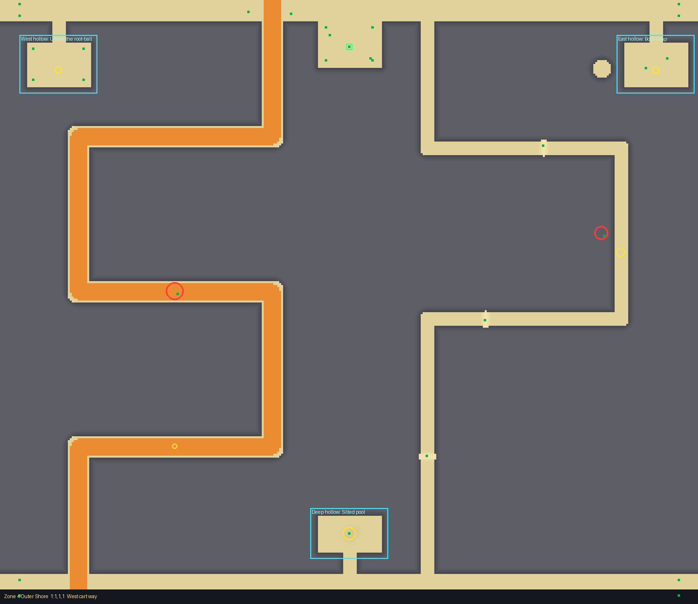
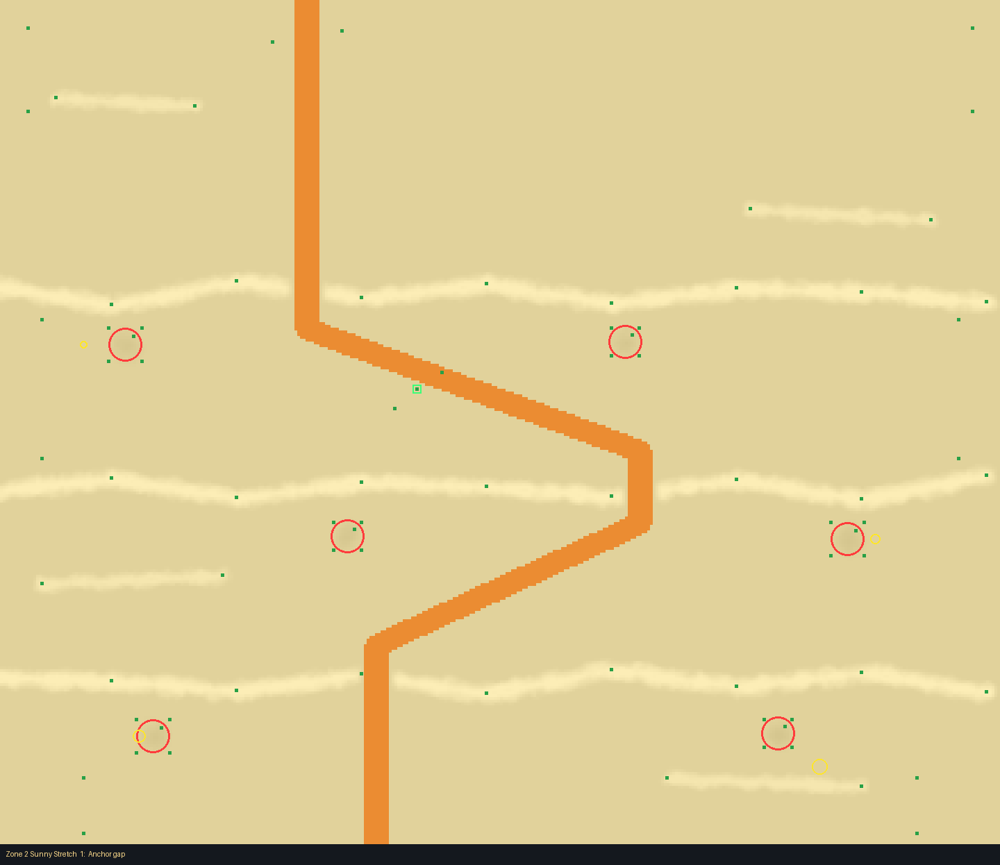

# Driftwood Cove (planned, common; zones 1 to 4)

Drawn with the layout kit from `tools/kit/plans/driftwood_cove.py` (edit the plan and run it, not
the layout). It writes `src/shared/Layouts/Biomes/DriftwoodCove.luau`, one layout per
zone. The card is `docs/design/cards/driftwood-cove.md`. No unique danger, but (the designer's
answer) open spike pits and quicksand in zones 3 and 4: `Pit` (radius 4, open) and `Sink`
(radius 10), off the cart route and in view. Zone 3: eight pits and six sinks across the flats
between the jams, those near a crossing's cart ramp left out. Zone 4: pits and sinks in the top
and bottom bands, and in each crossing's foot lane a quicksand and an open pit beside it (a gap
left to squeeze by). `Slow` wading in the dips stays.

Check it:  `python3 tools/kit/quick.py <zone> Biomes/DriftwoodCove --plan tools/kit/plans/driftwood_cove.py`

## Zones 1 to 3: open sand

Sand only: no walls, no rock, nothing above the zone's limit (zone 1: 2.4 of 2.5, zone 2: 4.6 of
5, zone 3: 6.4 of 7). One wide cart path per crossing (a 16-wide Ramp, cleared through
everything), three crossings per zone that differ by where the gaps are.

- **The jams** (zones 2 and 3): three low banks of piled logs across the whole beach, each worn
  and lumpy, wet dark sand behind them. A cart goes through the gap its crossing cuts in every
  jam (the ramp), slanting from gap to gap; the jam's flanks are too steep for a cart but not for
  a walker, so on foot you just climb the logs and save the zigzag. That is the shortcut (the
  test counts 5 start points; at least 2 are quicker on foot in every crossing).
- **Zone 1** may not hide the beach from the top (the test caps it at 20%), so its "jams" are two
  dark trenches across the beach (3 deep, 14 wide: the water pooling behind the logs), with log
  stacks beside them. A cart takes the ramp over each; a walker wades through. Same shortcut
  logic.
- **Dips** behind each jam: round hollows with weed and shells, each a `Slow` patch (kept clear
  of the cart ramp, so a cart is never held).
- **The entrance**: a flat spot at a hollow beached tree trunk (a big Driftwood with boughs
  round it), between two jams.
- **Loot** (Plank, Rope, Glass Bottle, Old Boot): in the dips, the best (weight 4) deepest, at
  the sea end.
- **Tells**: each crossing has a landmark beside its way in, at the top: an anchor, a crate, a
  chain (zone 1), or an arch of bones (zones 2 and 3).
- The beach's own rock pools and the pier are kept clear (zone 2 jams moved below z 210, ramps
  avoid the pools at (140, 120) in zone 2 and (-60, 130) in zone 3).

| Crossing | Gaps (x, per jam) | Zone 1 cart | Zone 2 cart | Zone 3 cart |
|---|---|---|---|---|
| Anchor gap | west, east, west | 38 s | 44 s | 46 s |
| Crate gap | east, west, east | 37 s | 45 s | 51 s |
| Chain gap (zone 1) / Ribs gap (zones 2, 3) | middle | 35 s | 43 s | 45 s |

On foot every crossing takes 30 s straight down (targets 35, 36, 38 s: 87%, 84%, 80%, inside
75% to 140%); a Huge cart takes the times above (all inside 140%: 49, 50 and 53 s).

## Zone 4: walled drift-rock

Weathered grey rock walls (12 high, drawn 24 thick) between carved lanes; top and bottom bands
open across the whole beach; two crossings, each **2 paths**:

- **The cart way** (20-wide lane, 16 ramp): three long switchbacks down one half of the beach
  (west in "West cart way", east in "East cart way"), about 1200 studs, 58 s for a Huge cart.
  A shallow wade pool on its middle switchback.
- **The foot way** (12-wide lane) down the other half: two rows, 1000 studs, 48 s. Low log
  stacks lie across the lane (3 high: too steep for a cart, a scramble on foot), and a pool
  slows you.
- Paths share 0% to 23% of their ground (the foot way and a third, mixed route).
- **Side hollows** off the top and bottom bands, each with two rooms: West hollow (Under the
  root-ball, Flooded hollow), East hollow (Boot-heap, Log cave: roofed), Deep hollow (Silted pool,
  Wedged hull: the best loot, weight 5, deepest). They are in the outer columns so every
  crossing reaches their doors through the bands. The east one sits clear of the beach's rock
  pool at (260, 70).
- **The entrance**: a trunk court off the top band (beached tree, timber, shells), flat at
  (0, 48).
- **Tells**: each crossing's way in has its own marks (anchor and driftwood in the west; crate
  and chain in the east).

Picture of zone 4 (crossing 1) and zone 2:

## Checks

- Quick check: no problems, every zone and room.
- `bash tools/check.sh`: all checks passed.
- Test Range (one zone at a time, `--no-routes`): terrain 0.02 to 0.08 studs off on average,
  worst 1.6 to 2.0 studs under the layout (nowhere near the wall tolerance); no floating or
  buried props of the layout's decor. The floating and buried props it lists are all the base
  zone's own cosmetics (`Map.Cosmetics`, `ZoneProps`: umbrellas, chairs, speckles) placed on the
  base ground, so over the trenches and dips they hang a little; those belong to the shore's
  cosmetics, not this layout.
