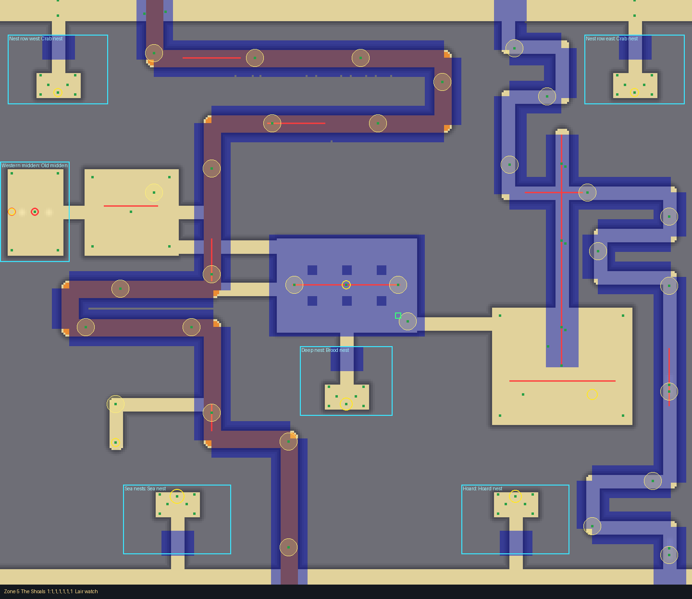
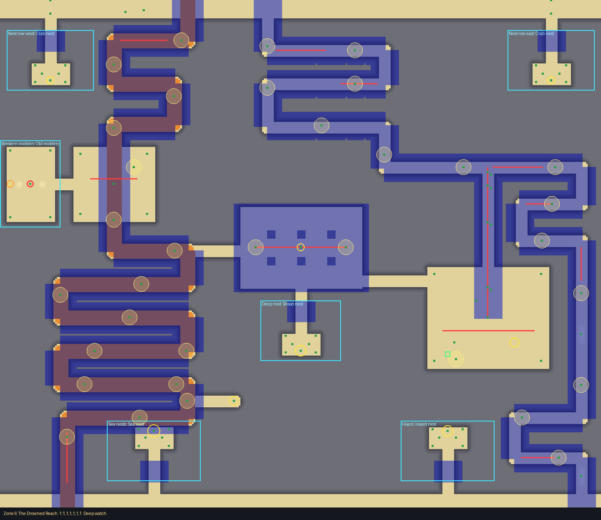

# Hermit Hollows

A giant hermit crab's warren (biome, rare; zones 4 to 6). Its card: `docs/design/cards/hermit-hollows.md`.
Drawn with the layout kit from `tools/kit/plans/hermit_hollows.py`: edit the plan and re-run it, never
`src/shared/Layouts/Biomes/HermitHollows.luau` by hand.

    python3 tools/kit/quick.py <4|5|6> Biomes/HermitHollows 1: 2: 3: 4: 5: --plan tools/kit/plans/hermit_hollows.py

A block of rock 20 high with the warren carved out of it: 12 wide tunnels (the cart's way 16 wide), mostly
roofed, glowing shells marking the safe ways, opening into chambers. Walls are drawn at least 24 thick.

## Built per zone (the same bones, different ways)

All three zones share the frame: the bands top and bottom, the **Midden Court** (west, open sky), the **Moult
Hall** (centre, roofed on pillars) and a third chamber on the east: the **Shell Court** in zone 4, the **Lair**
(bigger, where the giant's route begins) in zones 5 and 6. Slots (side pockets, each two rooms): nest rows
(NW, NE), the Western midden, the Deep nest, the Hoard and the Sea nests, plus the East collapse in zone 4.
Rooms are **crab nests** (a roofed tunnel to a chamber heaped with big shells: the best loot, BigShell
finds), **shell middens** (shell mounds, covered pits under the find) and **collapsed chambers** (boulders).
The deepest nests (Brood nest, Hoard, Sea nests) carry the highest weights. Four crabs always walk the
chambers. The entrance flat: zone 4 in the Midden Court (-224, 232), zone 5 in the Hall (54, 328), zone 6 in
the Lair (176, 424).

Every crossing has a Huge cart's way (a 16 wide ramp, top to bottom, clear of the giant's tunnel), foot paths
with rubble heaps a cart can't climb (so feet beat carts), 16 to 24 patrol crabs, a tell at the way in (a heap
of shells, bones, glowing shells), and dead ends with finds.

## Zone 4 (Outer Shore, target 55 s; window 41 to 77 s)

| # | Crossing | Paths | Times (quick check) | Cart | Character |
|---|---|---|---|---|---|
| 1 | Crab walk | 2 | 50, 60 s | 53 s | the cart's spine west; the east snake, foot only |
| 2 | Midden descent | 2 | 44, 48 s | 51 s | the cart's rows east; the west, through the Midden Court |
| 3 | Three ways | 3 | 48, 56, 68 s | 52 s | cart east; foot west; foot through the Hall |
| 4 | The long hollow | 1 | 47 s | 65 s | one long way (cart too), dead-end hoards |
| 5 | Moult run | 2 | 50, 66 s | 65 s | cart centre rows (a rubble shortcut for feet); the east snake |

No giant yet: crabs only (17 to 20 a tide), the middens' covered pits.

## Zone 5 (The Shoals, target 65 s; window 49 to 91 s)

| # | Crossing | Paths | Times | Cart | Giant's tunnel (burrows) |
|---|---|---|---|---|---|
| 1 | Lair watch | 2 | 53, 71 s | 74 s | north from the Lair, x 224, z 380 to 140 ((224,340) (224,250) (224,170)) |
| 2 | Bone road | 3 | 54, 59, 68 s | 58 s | south mouth, x 268, z 400 to 592 ((268,450) (268,520) (268,570)) |
| 3 | Nest road | 2 | 60, 61 s | 65 s | north, x 188, z 380 to 120 ((188,340) (188,262) (188,190) (188,140)) |
| 4 | Hunter's gate | 3 | 50, 54, 67 s | 53 s | north, x 268, z 380 to 188 ((268,340) (268,264) (268,214) (268,196)) |
| 5 | Midden maze | 2 | 54, 63, 78 s | 65 s | north, x 164, z 380 to 126 ((164,340) (164,270) (164,210) (164,150)) |

## Zone 6 (The Drowned Reach, target 85 s; window 64 to 119 s)

| # | Crossing | Paths | Times | Cart | Giant's tunnel (burrows) |
|---|---|---|---|---|---|
| 1 | Deep watch | 2 | 71, 73 s | 79 s | north, x 224, z 380 to 200 ((224,344) (224,266) (224,222) (224,206)) |
| 2 | Shell stair | 3 | 65, 67, 75 s | 68 s | south mouth, x 268, z 400 to 592 ((268,450) (268,500) (268,540) (268,576)) |
| 3 | Fallen way | 2 | 67, 73 s | 79 s | north, x 188, z 380 to 120 ((188,340) (188,262) (188,210) (188,140)) |
| 4 | The three gates | 3 | 64, 65, 67 s | 68 s | north, x 268, z 380 to 240 ((268,344) (268,300) (268,264) (268,248)) |
| 5 | Brood maze | 2 | 70, 73 s | 79 s | north, x 164, z 380 to 126 ((164,340) (164,270) (164,210) (164,150)) |

## Dangers

- **Patrol crabs** walk stretches of the tunnels back and forth, across the ways (16 to 24 in a zone, Calls on
  so one that spots you drums for the giant). Time them.
- **The giant** (zones 5 and 6, one per crossing): a 12 wide tunnel it fills, straight out of the Lair, roofed.
  The foot paths cross it at their rows (some two or three times, or through the Lair itself); each burrow hole
  (churned sand, rocks) lies between two crossings so it can come up behind or ahead of you. The cart's way keeps
  clear of it. Lanterns draw it.
- **Covered pits** under the finds in the middens.

## Test Range

Zone 4, 5 and 6, first crossing and rooms: no buried or floating layout things; terrain 0.3 studs off the layout
on average, worst -2.7 (zone 5), -1.9 (zone 6): inside the 3 stud wall tolerance. Small tolerances: coral rubble
specks 0.2 to 0.6 under the ground, crab models 1 stud over it (zone 4), the rock pool water 1.1 over it.
`tools/check.sh`: all pass except the barrel test ("barrels teeter at the top of their gully first"), which
fails on the base this branch started from and is not part of the layout.
