# Hermit Hollows

A giant hermit crab's warren (biome, rare; zones 4 to 6). Its card: `docs/design/cards/hermit-hollows.md`.
Drawn with the layout kit from `tools/kit/plans/hermit_hollows.py`: edit the plan and re-run it, never
`src/shared/Layouts/Biomes/HermitHollows.luau` by hand.

    python3 tools/kit/quick.py <4|5|6> Biomes/HermitHollows 1: 2: 3: 4: 5: --plan tools/kit/plans/hermit_hollows.py

A block of rock 20 high with the warren carved out of it: 12 wide tunnels (the cart's way 16 wide, the giant's
tunnels 20 wide so it fits), mostly roofed, glowing shells marking the safe ways, opening into chambers. Walls
are drawn at least 24 thick.

## Built per zone (the same bones, different ways)

All three zones share the frame: the bands top and bottom, the **Midden Court** (west, open sky), the **Moult
Hall** (centre, roofed on pillars) and a third chamber on the east: the **Shell Court** in zone 4, the **Lair**
(bigger, where the giant's tunnels begin) in zones 5 and 6. Slots (side pockets, each two rooms): nest rows
(NW, NE), the Western midden, the Deep nest, the Hoard and the Sea nests, plus the East collapse in zone 4.
Rooms are **crab nests** (a roofed tunnel to a chamber heaped with big shells: the best loot, BigShell
finds), **shell middens** (shell mounds, covered pits under the find) and **collapsed chambers** (boulders).
The deepest nests (Brood nest, Hoard, Sea nests) carry the highest weights. Four crabs always walk the
chambers. The entrance flat: zone 4 in the Midden Court (-224, 232), zone 5 in the Hall (54, 328), zone 6 in
the Lair (176, 424).

Every crossing has a Huge cart's way (a 16 wide ramp, top to bottom), foot paths
with rubble heaps a cart can't climb (so feet beat carts), 16 to 24 patrol crabs, a tell at the way in (a heap
of shells, bones, glowing shells), and dead ends with finds.

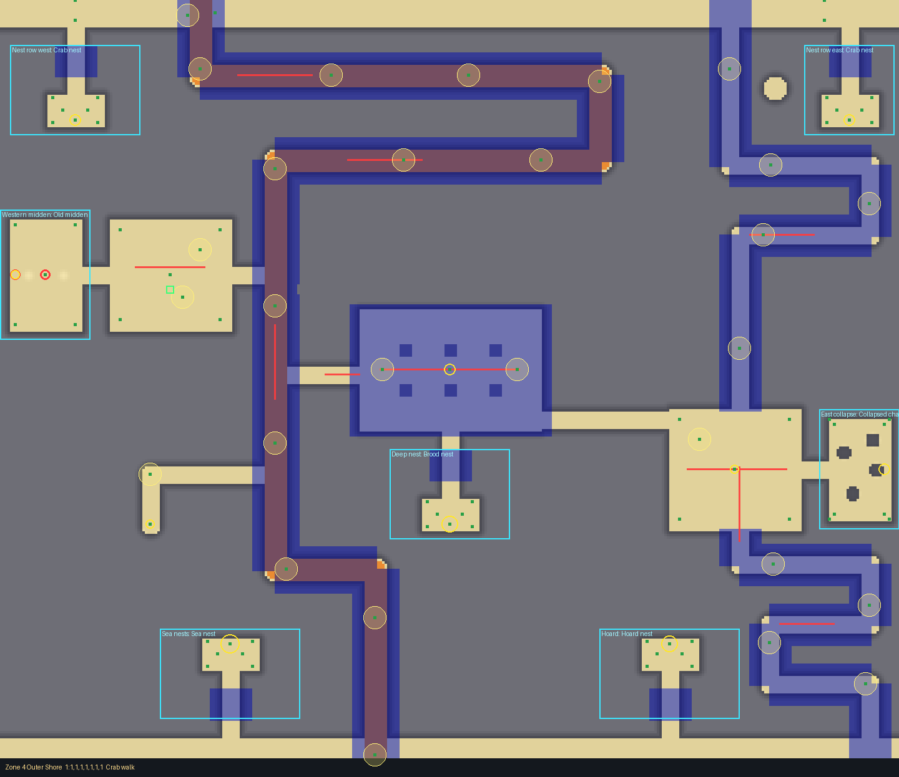

Zones 5 and 6, each crossing: the giant's tunnels in magenta (the line is where it walks, the dots are the
junctions and corners), its burrows as the big magenta rings. Patrols are the red lines.

| Zone 5 | Zone 6 |
|---|---|
| 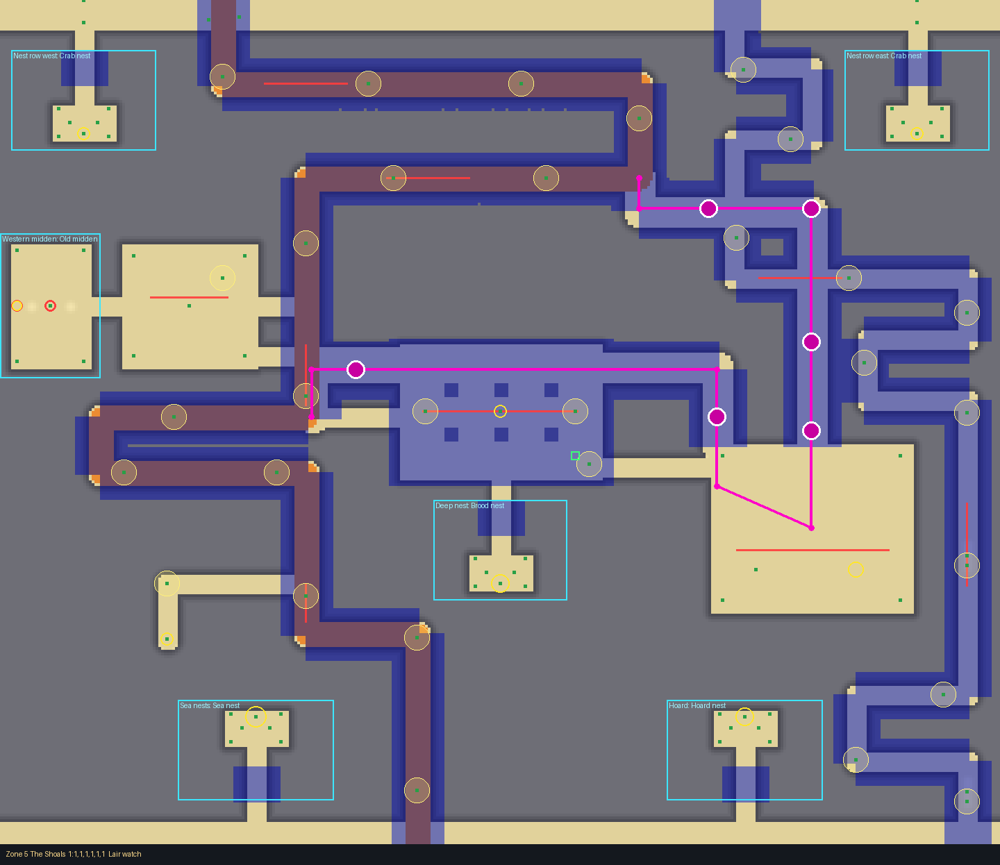 | 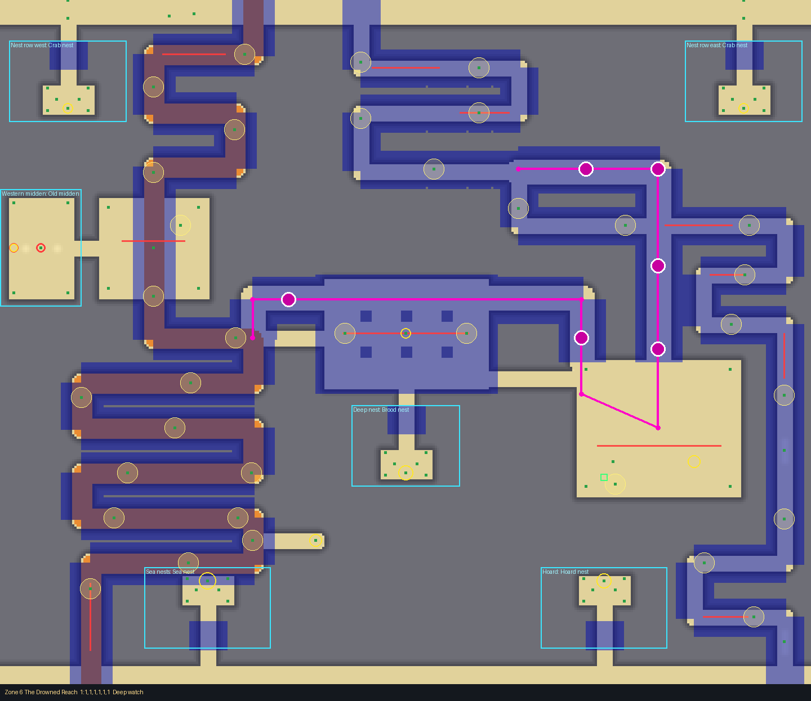 |
| 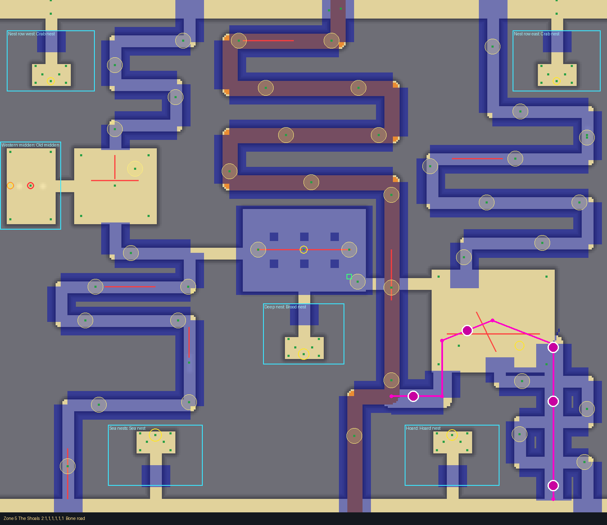 | 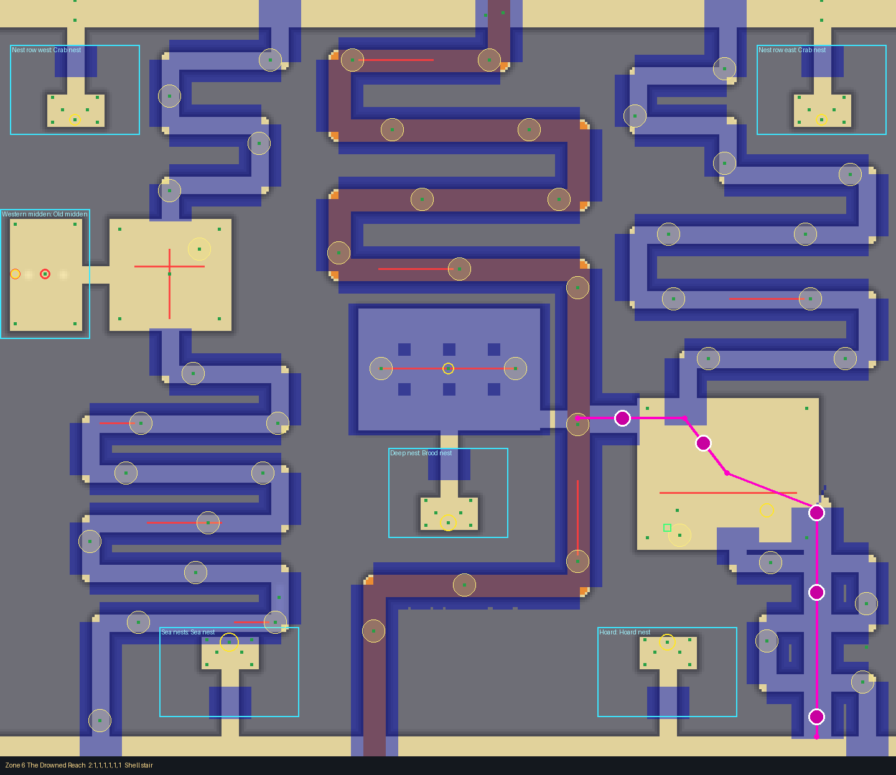 |
| 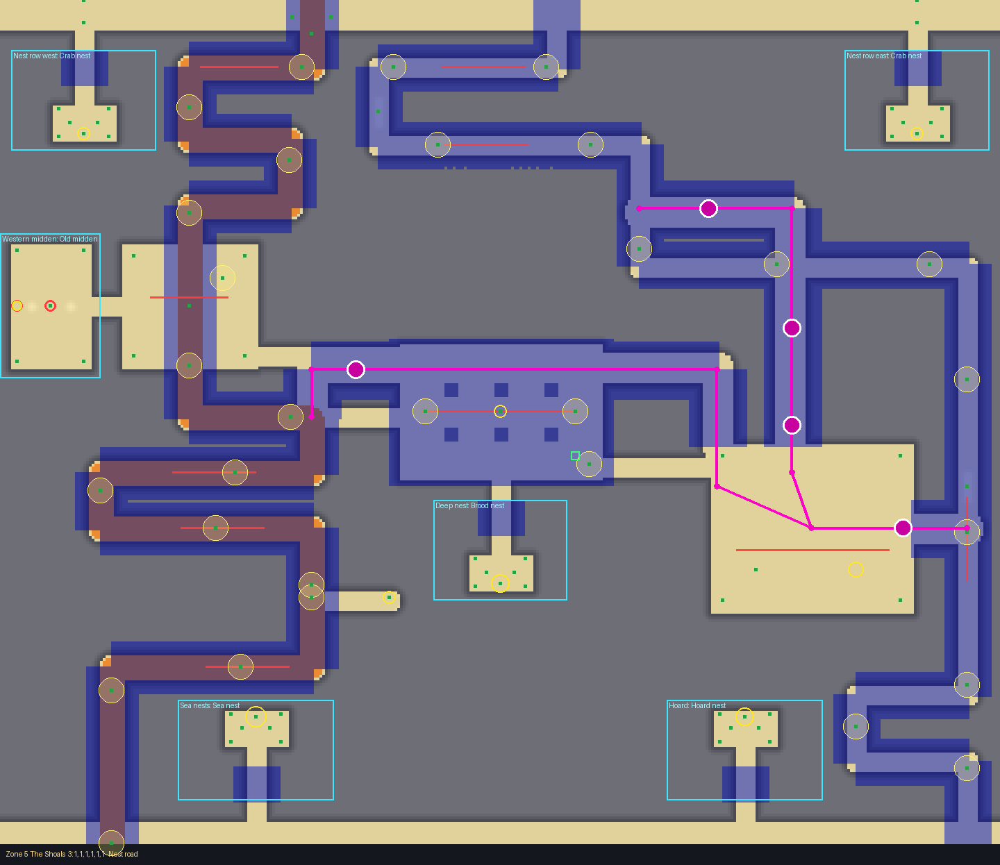 | 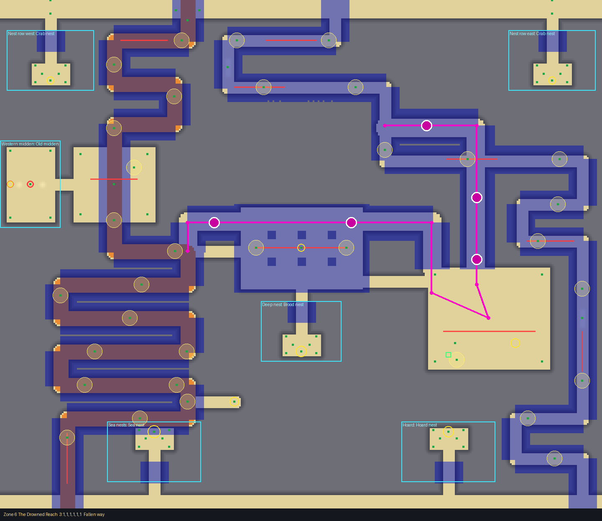 |
| 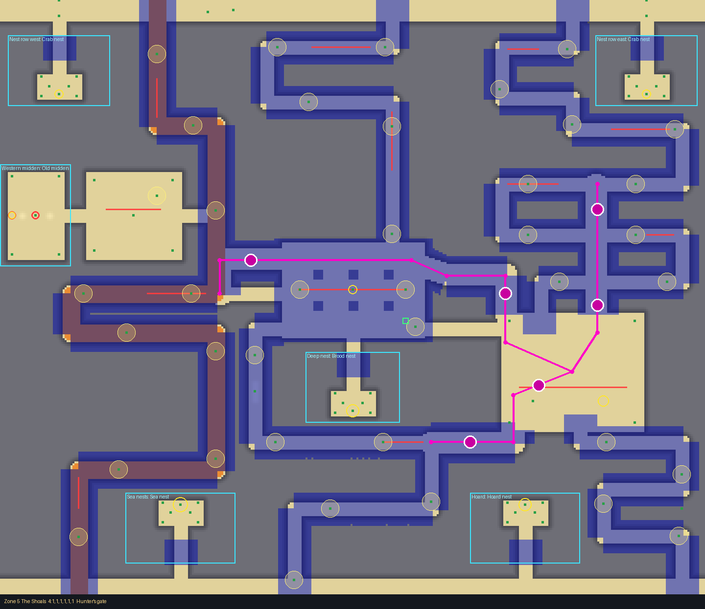 | 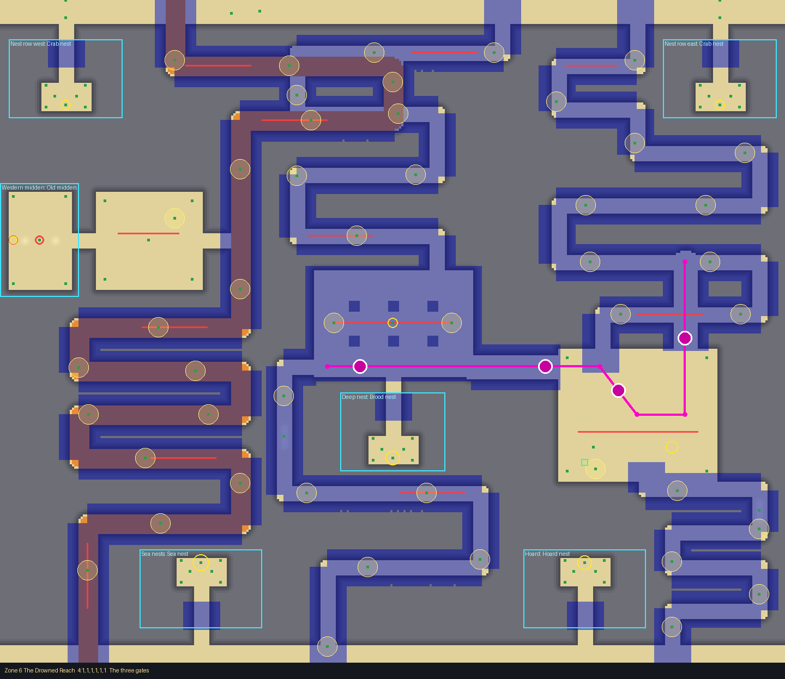 |
| 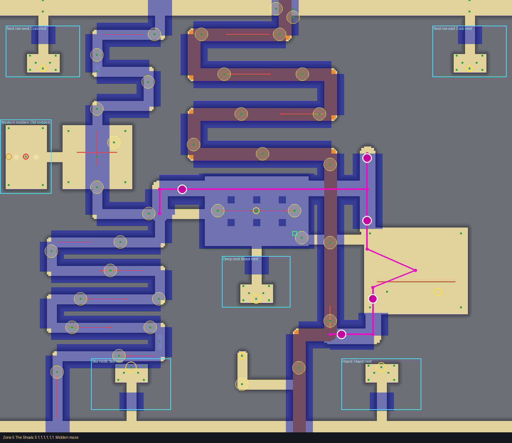 | 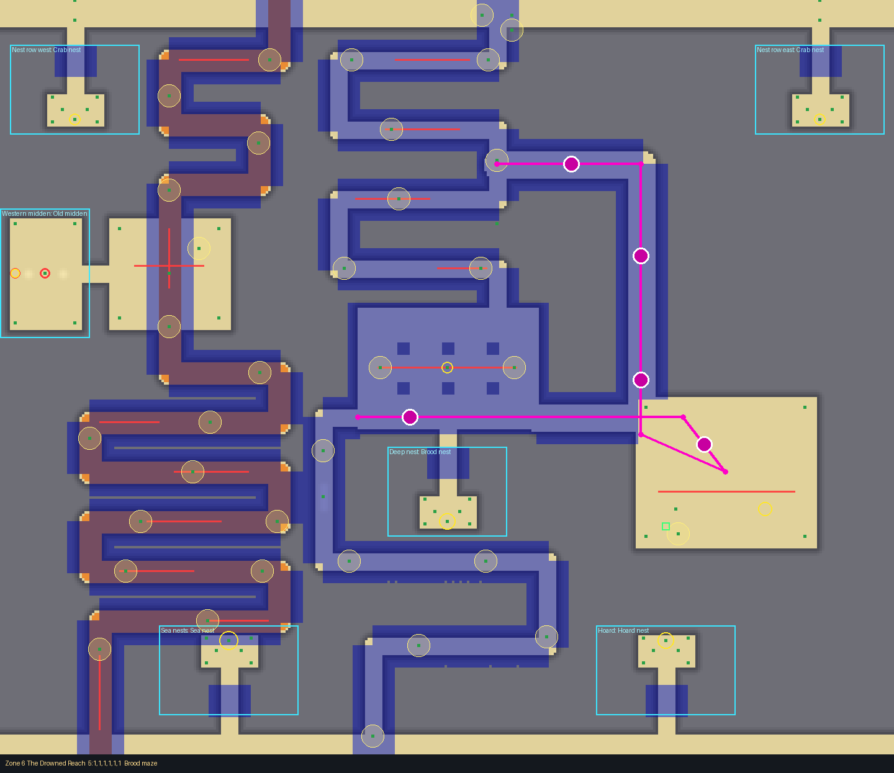 |

## Zone 4 (Outer Shore, target 55 s; window 41 to 77 s)

| # | Crossing | Paths | Times (quick check) | Cart | Character |
|---|---|---|---|---|---|
| 1 | Crab walk | 2 | 50, 60 s | 53 s | the cart's spine west; the east snake, foot only |
| 2 | Midden descent | 2 | 44, 48 s | 51 s | the cart's rows east; the west, through the Midden Court |
| 3 | Three ways | 3 | 48, 56, 68 s | 52 s | cart east; foot west; foot through the Hall |
| 4 | The long hollow | 1 | 47 s | 65 s | one long way (cart too), dead-end hoards |
| 5 | Moult run | 2 | 50, 66 s | 65 s | cart centre rows (a rubble shortcut for feet); the east snake |

No giant yet: crabs only (17 to 20 a tide), the middens' covered pits.

## Zone 5 (The Shoals, target 65 s; window 49 to 91 s)

| # | Crossing | Paths | Times | Cart |
|---|---|---|---|---|
| 1 | Lair watch | 2 | 52, 71 s | 74 s |
| 2 | Bone road | 3 | 54, 60, 70 s | 58 s |
| 3 | Nest road | 2 | 59, 59 s | 65 s |
| 4 | Hunter's gate | 3 | 50, 55, 67 s | 53 s |
| 5 | Midden maze | 2 | 54, 67, 78 s | 65 s |

## Zone 6 (The Drowned Reach, target 85 s; window 64 to 119 s)

| # | Crossing | Paths | Times | Cart |
|---|---|---|---|---|
| 1 | Deep watch | 2 | 71, 73 s | 79 s |
| 2 | Shell stair | 3 | 65, 67, 75 s | 69 s |
| 3 | Fallen way | 2 | 66, 73 s | 79 s |
| 4 | The three gates | 3 | 64, 65, 67 s | 72 s |
| 5 | Brood maze | 2 | 70, 73 s | 79 s |

## The giant's tunnels and burrows

The giant (zones 5 and 6) hunts a maze: 2 or 3 tunnels per crossing, 20 wide, roofed outside the chambers,
that begin in the Lair (the open chamber, x 152 to 296, z 320 to 440; the giant starts at (224, 380)) and meet
at junctions. Its Hunter placement is `Routes` (the tunnels) and `Burrows` (4 to 6, each on a tunnel, at least
60 studs apart, at mouths and chambers beside the paths, never in a foot lane). A tunnel may cross or join a
path, but each path is touched only where the giant's way between two touches is no shorter than the path's own
(otherwise it is a shortcut and the path falls under 75% of the target); so the tunnels that run to the bottom
(the south column) are kept to the crossings that already had one. The Hall route runs along z 266, above the
pillars, away from zone 5's entrance flat at (54, 328). `HazardService._tunnels` on each: one connected network
(10 of 10), 5 to 8 nodes in zone 6 and 6 to 12 in zone 5.

Zone 5:

| # | Tunnels | Where they meet the paths | Burrows |
|---|---|---|---|
| 1 Lair watch | 2: north from the Lair on x 224 to z 150, west along z 150 to the cart's corner (100, 128); the Hall route (Lair, x 156 up to z 266, west to (-136, 300)) | B's row z 200 at (224, 200) and its column x 170 at (170, 150); the cart's way at (100, 128) and at the west rows (-136, 300) | (224,310) (224,246) (224,150) (150,150) (156,300) (-104,266) |
| 2 Bone road | 2: south on x 296 across the three bottom east rows to z 592; south-west (164, 404), (164, 470) to the cart's corner (104, 470) | the east path's three rows (z 452, 500, 548) and its Lair; the cart's way at (104, 470) | (296,412) (296,476) (296,576) (130,470) (194,392) |
| 3 Nest road | 3: north on x 210 to z 150, west to B's column (100, 150); the Hall route; east to B's long run (336, 380) | B's row z 190 at (210, 190), its column x 100 at (100, 150), its long run at (336, 380); the cart's way at (-136, 300) | (210,306) (210,236) (150,150) (290,380) (-104,266) |
| 4 Hunter's gate | 3: north on x 250 across the east snake's rows z 288, 240 to its row z 188; the Hall route (through the centre path, west to the cart's way); south-west to the centre path's corner (80, 452) | the east snake (3 touches) and its Lair; the centre path in the Hall and at (80, 452); the cart's way at (-136, 300) | (250,312) (250,214) (156,300) (-104,266) (120,452) (190,394) |
| 5 Midden maze | 3: north from the Lair on x 156 to z 216; west on z 266 across the cart's column x 104, through the Hall, to (-136, 300); south-west to the cart's corner (104, 470) | the cart's way at (104, 266) and (104, 470); the west rows at (-136, 300) | (156,310) (156,222) (-104,266) (164,420) (120,470) |

Zone 6:

| # | Tunnels | Where they meet the paths | Burrows |
|---|---|---|---|
| 1 Deep watch | 2: north on x 224 to z 150, west to B's corner (100, 150); the Hall route | B's row z 200 and its corner (100, 150); the cart's way at (-136, 300) | (224,310) (224,236) (224,150) (160,150) (156,300) (-104,266) |
| 2 Shell stair | 2: south on x 296 across the three bottom east rows to z 592; west along z 336 to the cart's column (104, 336) | the east path's three rows and its Lair; the cart's way at (104, 336) | (296,412) (296,476) (296,576) (140,336) (205,356) |
| 3 Fallen way | 2: north on x 210 to z 150, west to B's column (100, 150); the Hall route | B's row z 190 and its column x 100; the cart's way at (-136, 300) | (210,310) (210,236) (150,150) (60,266) (-104,266) |
| 4 The three gates | 2: north on x 268 across the east snake's row z 288 to its row z 240; west along the Hall (z 336) to the centre path's start | the east snake (2 touches) and its Lair; the centre path in the Hall | (268,310) (207,358) (140,336) (-30,336) |
| 5 Brood maze | 2: north on x 156 to z 132, west to the centre rows (40, 132); west along the Hall (z 336) | the centre path at (40, 132) and in the Hall | (156,306) (156,206) (100,132) (207,358) (-30,336) |

Zone 6's crossings 4 and 5 leave the far west cart's way (and, in 5, the west) out of the maze: a tunnel to it
through the Hall's west door would join the west path to the centre path's tail and cut it under 75% of the
target (the checks catch it). The tunnels are trees (a loop of tunnels and the paths' own limits do not fit
together here), so the giant turns back at their ends.

## Dangers

- **Patrol crabs** walk stretches of the tunnels back and forth, across the ways (16 to 24 in a zone, Calls on
  so one that spots you drums for the giant). Time them.
- **The giant** (zones 5 and 6, one per crossing): hunts a maze of 2 or 3 tunnels from the Lair (see above), going
  the shortest way through them toward where it thinks you are, and digging to the burrow nearest its guess on any
  of them. Its 4 to 6 burrow holes (churned sand, rocks) lie at tunnel mouths and chambers beside the paths, never
  in a foot lane, so it can come up behind or ahead of you. Lanterns draw it.
- **Covered pits** under the finds in the middens.

## Test Range

Zone 4, 5 and 6, first crossing and rooms: no buried or floating layout things; terrain 0.3 studs off the layout
on average, worst -2.7 (zone 5), -1.9 (zone 6): inside the 3 stud wall tolerance. Small tolerances: coral rubble
specks 0.2 to 0.6 under the ground, crab models 1 stud over it (zones 4 to 6), the rock pool water 1.1 over it.
`tools/check.sh`: all pass except the barrel test ("barrels teeter at the top of their gully first"), which
fails on the base this branch started from and is not part of the layout.
