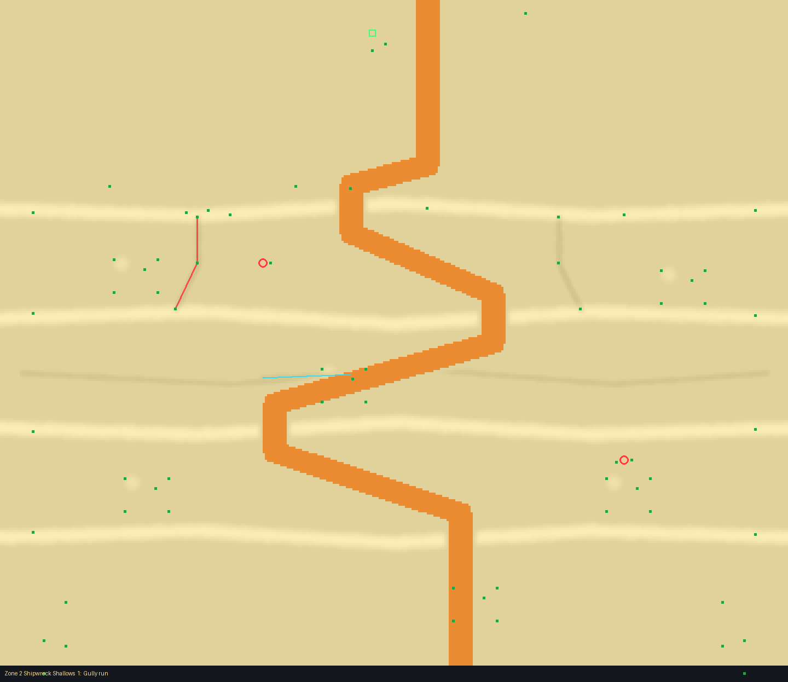
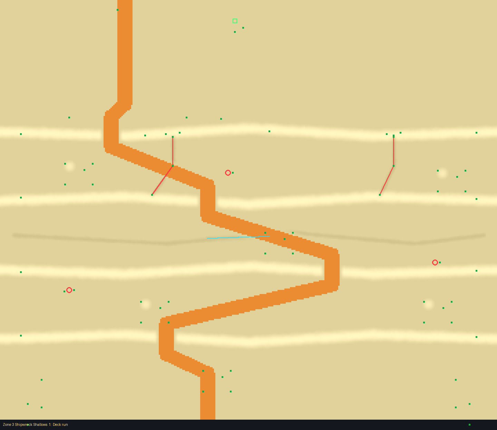
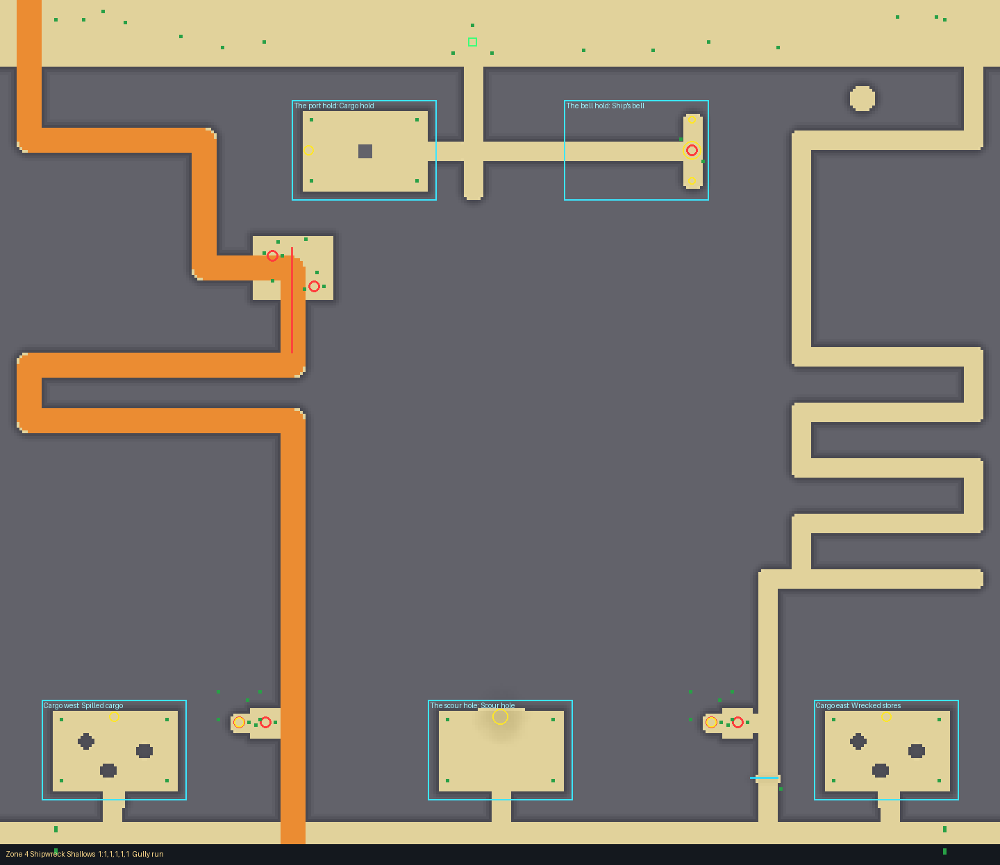
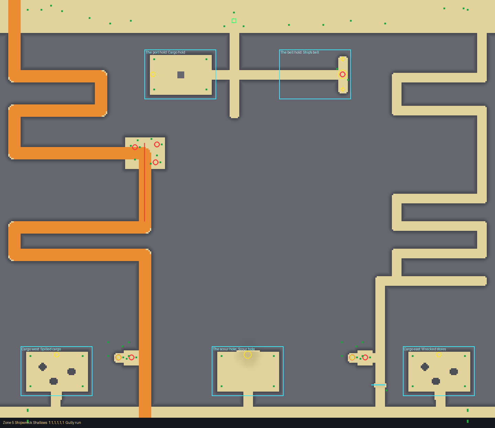
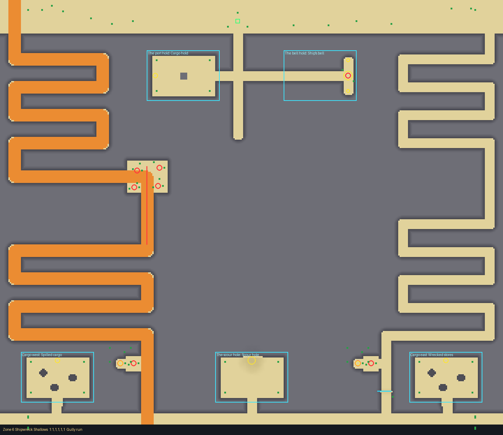

# Shipwreck Shallows (biome, uncommon; zones 2 to 6)

Drawn with the layout kit from `tools/kit/plans/shipwreck_shallows.py` (edit the plan and re-run
it, not the Luau). The card: `docs/design/cards/shipwreck-shallows.md`.

One big wreck broken on the sand, the barrels still rolling off her deck down the gullies, scour
channels with an undertow, spike pits in the rotten decking and debris. Each zone is its own
layout, with five crossings (zones 2 and 3: two or three).

## Zones 2 and 3: the wreck lies low (open sand, no walls)

Four full-width banks of sand-buried wreckage cross the zone (the first at z 190 is her hull,
ribs standing out of it), with a strip between each: heights 4.4 (zone 2, cap 5) and 6.4
(zone 3, cap 7). Carts cannot climb a bank; the one wide ramp (20) of each crossing opens a gap
through each, at a different x each time; feet go straight over (the shortcuts). Gullies start
at the hull's deck and run down the first strip (the barrels' ways); a scour channel with an
undertow crosses the next strip; spike pits (open and covered) lie in the debris.

| Zone | Crossings | Foot, fastest | Huge cart |
|---|---|---|---|
| 2 (target 36 s) | Gully run, Port side, Under the stern | 30 s (85%) | 46, 48, 46 s |
| 3 (target 38 s) | Deck run, Starboard way | 33 to 35 s (87 to 91%) | 50, 47 s |

## Zones 4 to 6: the hull is a wall

The hull is the rock between the top band and the stern. Down it runs the hatch passage (the
entrance, at x -20, flat with the biome's EntranceSpots on the top band), with the two holds
off it (the port hold, and the bell hold deepest: the best crates and the ShipBell). The zone is
three sectors, west, centre (the hatch) and east; a crossing's paths each keep to their own, so
no link between them cuts a path short.

- **Flank**: switchbacks down the side of the hull to the stern.
- **Gully**: from a scupper at the stern (rotten planking: pits) straight down x +-150, then the
  scour's rows. The barrels start at the scupper and roll down the gully.
- **Mound rows**: the slow, safe way (a second set of switchbacks below the flank).
- **Centre**: through the hatch and out of the stern, switchbacks down the middle (foot).
- **Rooms**: the holds, cargo piles, the scour hole (off the bottom band), each with two rooms.
- Fords: a scour channel across a lane, with an undertow (foot lanes only: a channel on a ramp
  stops carts, so the cart ramps have none). Pit spurs off the chutes: a find on a covered pit,
  an open pit in the mouth. Pits per crossing: scuppers 2, 3, 4 (zones 4, 5, 6) plus a spur.

| Crossing | Paths | Zone 4 (55 s) | Zone 5 (65 s) | Zone 6 (85 s) |
|---|---|---|---|---|
| Gully run | 2: west flank and gully (ramp, barrels), east mounds | 54, 57 s | 57, 65 s | 79, 91 s |
| Through the hatch | 2: east gully (ramp, barrels), the hatch and the centre | 54, 67 s | 65, 75 s | 75, 91 s |
| The long gully | 1: west flank, across the stern, east gully (ramp) | 69 s | 80 s | 107 s |
| Three ways | 3: west gully (ramp), hatch and centre, east mounds | 54, 57, 67 s | 57, 65, 75 s | 75, 79, 91 s |
| Scour round | 2: west mounds (ramp), east gully | 55, 56 s | 56, 66 s | 77, 93 s |

Huge cart's way (a ramp 16, top to bottom): zone 4 56 to 71 s, zone 5 60 to 83 s, zone 6 83 to
113 s: all inside 75% to 140% of the target (41 to 77, 49 to 91, 64 to 119 s).

Barrels: one Roller per gully path (several per zone: one in each crossing, two in zone 2's
third and zone 3's first). Undertow: in the fords and the open zones' scour channel. Pits:
the scuppers, the pit spurs, the bell hold's covered pit under the bell.

## Checks

- `bash tools/check.sh`: all checks passed.
- Test Range (`--all ShipwreckShallows --no-routes`, once per zone): terrain agrees with the
  layout to 0.2 to 0.3 studs on average. Tolerances noted: ground-texture specks and a rock
  pool's water floating or buried by up to 1.4 studs (cosmetic, not the layout's), and in zone 6
  one cell 3 studs off at (-160, 3284) where the scupper's open spike pit is cut (a pit is a cut
  deeper than the layout's ground, by design).

## Pictures

 
 

