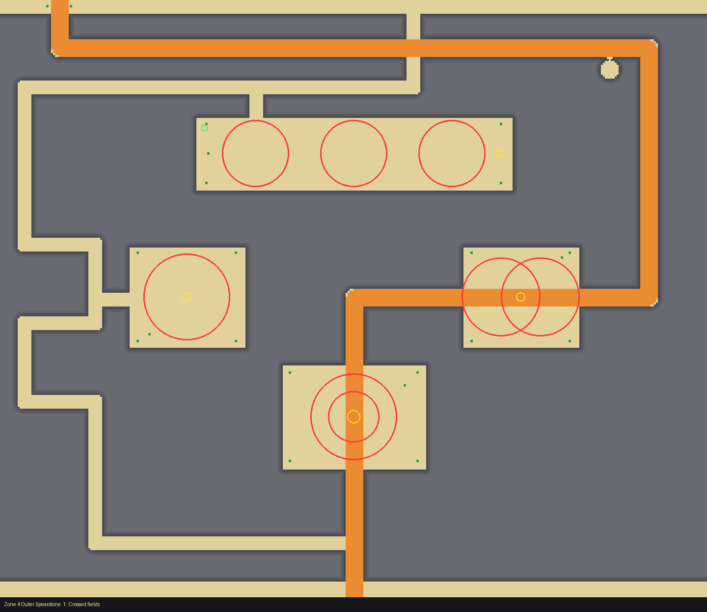
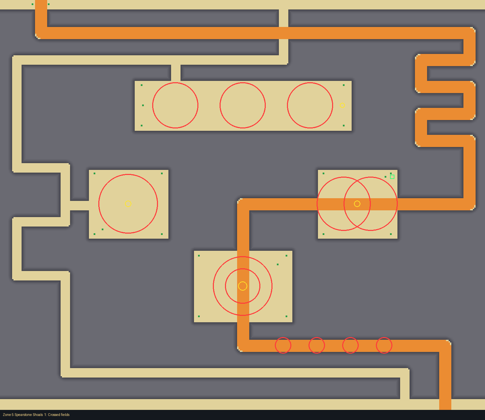
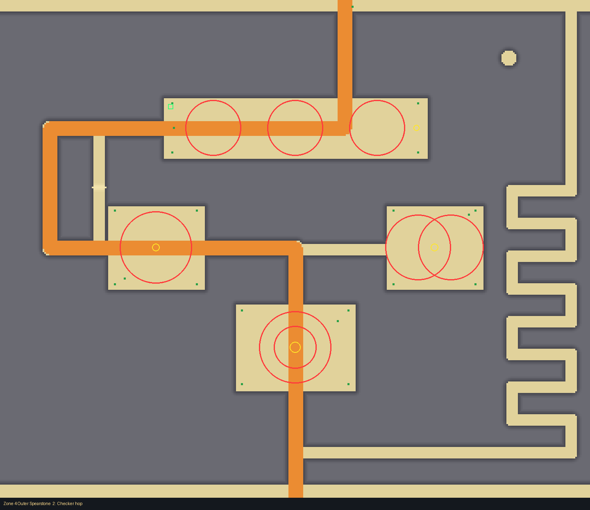
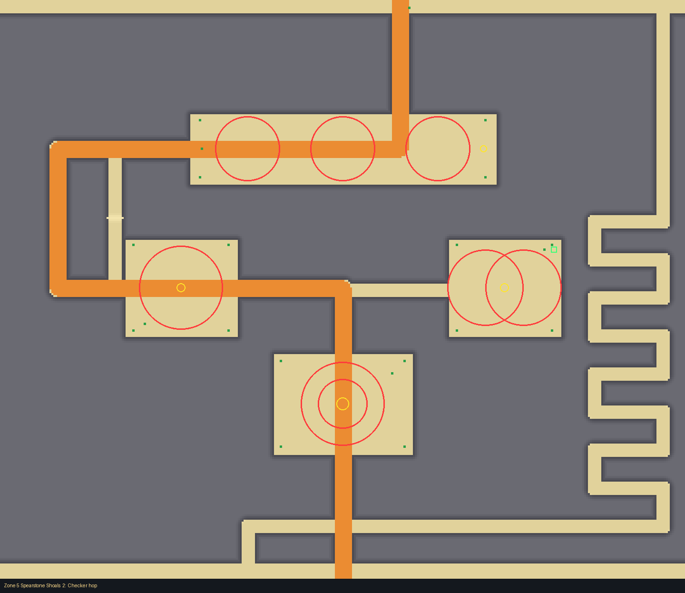
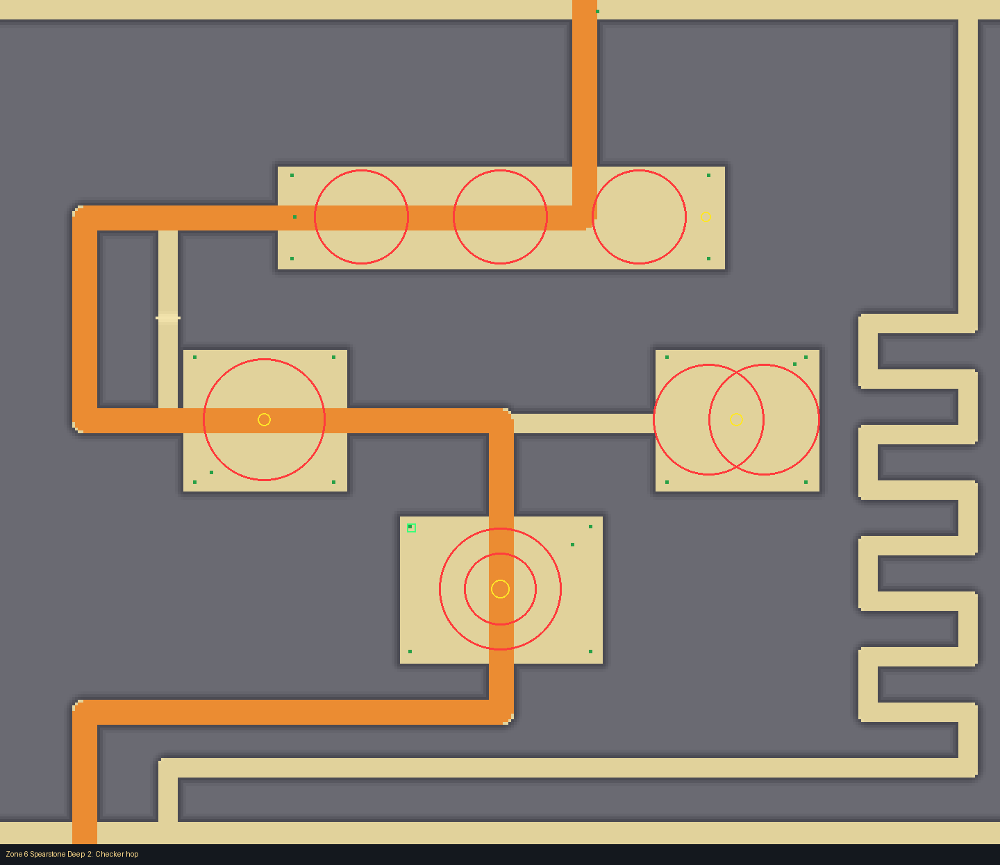

# Spearstone Reef (biome, zones 4 to 6)

A black basalt reef (card: `docs/design/cards/spearstone-reef.md`), drawn with the layout kit from
`tools/kit/plans/spearstone_reef.py` into `src/shared/Layouts/Biomes/SpearstoneReef.luau`:
edit the plan and re-run it, never the Luau.

    python3 tools/kit/quick.py 6 Biomes/SpearstoneReef --plan tools/kit/plans/spearstone_reef.py

A block of rock 18 high with halls and corridors carved out of it (walls drawn 24 thick). The
obstacle course: each hall is a different challenge, and spears do more damage deeper in
(Damage 35 in zone 4, 60 in zone 5, 100 in zone 6).

## The halls (the frame, the same in every zone)

| Hall | Challenge | Find |
|---|---|---|
| Wave hall (north) | three Wave fields in a row: run behind each wave | weight 2, east end |
| Checker hall (west) | one big Checker field: hop between the squares | weight 3, in the field |
| Overlap hall (east) | a Wave and a Checker field laid over one another | weight 3, where they meet |
| Ring hall (middle) | two concentric Ring fields round the prize | weight 5, at the middle |
| Spear corridor | four small fields in sequence (Wave, Checker, Wave, Ring) on the way down the middle (crossing 3) | on the way |
| Bottom row | four small fields along a lane (crossing 1) | on the way |

The halls are islands in the rock: only the crossings connect them (every crossing reaches every
hall, so every find and each zone's entrance spot can be walked to). Decor: broken spearstones
(Rocks), barnacles, bones; a tell at each crossing's way in.

Entrance spots: zone 4 the Wave hall's north-west corner, zone 5 the Overlap hall's north-east
corner, zone 6 the Ring hall's north-west corner (all outside the fields).

## Crossings and times (quick check; target 55 / 65 / 85 s)

| Crossing | Paths | Zone 4 | Zone 5 | Zone 6 |
|---|---|---|---|---|
| 1 Crossed fields | cart ramp across the top and down the east through the Overlap and Ring halls (a switchback on the east side in zones 5 and 6); a foot lane round the west columns | 55, 70 s | 82, 82 s | 82, 82 s |
| 2 Checker hop | cart ramp through the Wave, Checker and Ring halls; a foot serpentine down the east side; a rubble scramble across the ramp's west detour (foot only) | 54, 68 s | 54, 68 s | 68, 79 s |
| 3 Spear corridor | cart ramp straight down the middle through the Wave hall, the corridor of fields and the Ring hall, then round the bottom; a foot lane round the east | none | 62, 69 s | 71, 79 s |

The scramble (`scramble()` in the plan): a 12 wide lane from the ramp's top leg (-240, 156) straight
down to its Checker leg (-240, 302), with a 3 high bank of rubble across it. Feet clamber it,
carts can't, so it cuts the 300 stud detour west for feet alone. Foot against cart at the test's
five starts (-300, -150, 0, 150, 300): crossing 2 in every zone is faster on foot at all five
(it was one: the east serpentine at x 300); crossings 1 and 3 already had two or more. The
scramble keeps its shortest path at 99%, 83% and 80% of target (zones 4, 5, 6). (A bank laid
along a lane leaves a groove of unraised cells a cart can follow, so the bank lies across it.)

Zone 4 has two crossings, zones 5 and 6 three. Every crossing has a Huge cart's way (the 16 wide
Ramp, top to bottom, through fields that carts time too). Tells: a pair of broken spears (1), a
hull's ribs (2), a chain and a broken spear (3).

Crossing 2 with its scramble (the thin lane with the rubble bank, west of the first room):

## Checks

- It rolls: moved into `Biomes.List` (Layouts/Biomes/SpearstoneReef.luau).
- Quick check: no problems in any zone (every path 75% to 140% of target).
- `bash tools/check.sh`: All checks passed.
- Test Range (`--zone n --tile n=Biomes/SpearstoneReef`, crossing 1): terrain against the
  layout 0.15 to 0.31 studs on average, worst 1.8 to 2.5; the only reports are a few buried or
  floating cosmetics and props of the zone's own (not the layout's).

## Open items

- No slots (side rooms) yet: the halls are the rooms.
- Spear behaviour is another agent's; fields are only placed here.
