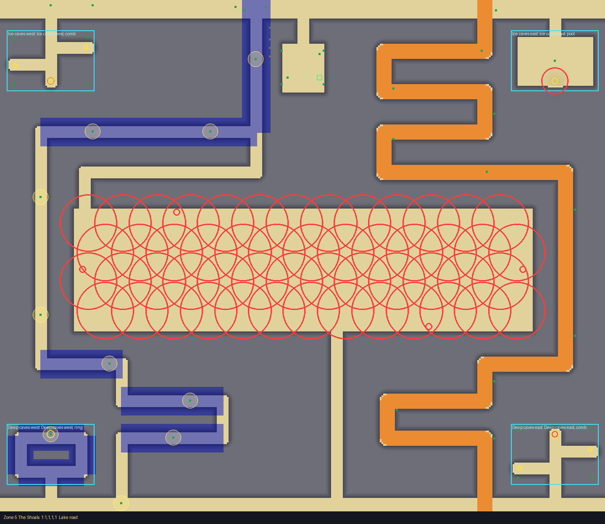
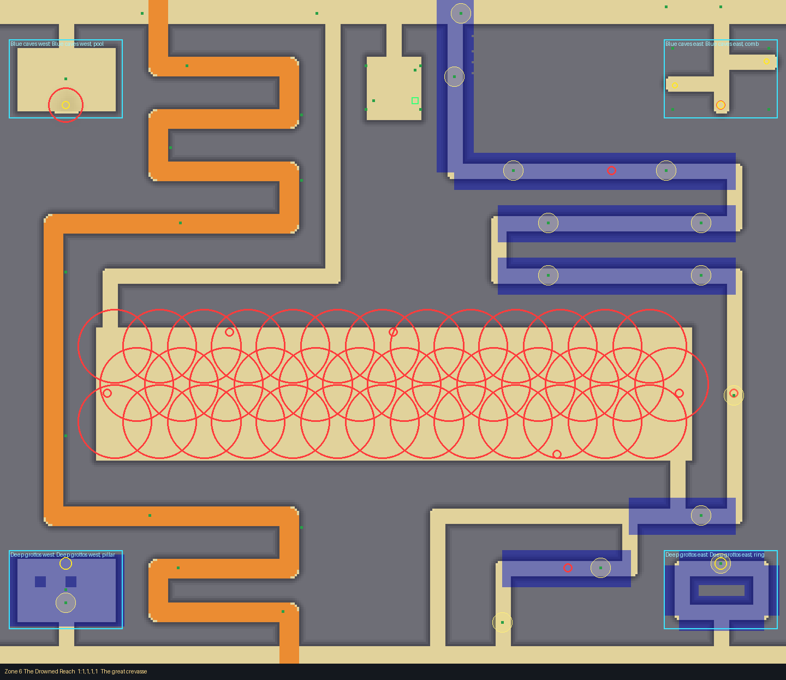

# Stranded Iceberg (planned biome, zones 5 and 6)

An iceberg run aground (card: `docs/design/cards/stranded-iceberg.md`). Drawn with the layout
kit from `tools/kit/plans/stranded_iceberg.py` into
`src/shared/Layouts/Biomes/StrandedIceberg.luau`: edit the plan and re-run it.

    python3 tools/kit/quick.py 5 Biomes/StrandedIceberg --plan tools/kit/plans/stranded_iceberg.py

Walls and roofs are Glacier (rock 20 high), lanes and bands are painted Snow, the lake's floor
Glacier. Per the card's answer there is no cart spilling: the Ice hazard is placement only
(`At` + `Radius`, big overlapping patches); its sliding is built elsewhere.

## The three kinds of way (2 or 3 in each crossing)

- **The lake**: a wide flat hall (544 across) covered with overlapping Ice patches (radius 34):
  the quick way, in at one far corner and out at the other. Open crevasses (uncovered Pits,
  radius 4) sit at its edges and you can slide into them.
- **The tunnels**: narrow 12-wide roofed lanes lit only by glow shells; covered crevasses (Pit,
  covered, cracks the tell) in zone 6's tunnels. Foot and small carts.
- **Round the berg**: the cart's ramp (16 wide, Huge fits), serpentining through the top and
  bottom rows and down a side column, rocks and pebbles at its side.

## Frame (both zones)

Top and bottom bands, four corner slots (ice caves, 2 rooms each, doors on the bands; best
Frozen Fish loot deepest, on covered crevasses in the comb caves), and **Pip's court**: a flat
open 48 x 56 court straight off the top band at x 0, z 52 to 108 (Pip, the trader, stands at its
middle, (0, 80)). The entrance spot is in it at (20, 92), reachable on foot. Decor: Rocks,
Pebbles, Bones, Chain sparingly; GlowShells in tunnels and the ring caves.

## Zone 5 (target 65 s): the lake across the middle (z 248 to 392)

| # | Crossing | Paths | Times (quick check) |
|---|---|---|---|
| 1 | Lake road | 3: lake, west tunnels, east cart ramp | 50, 57, 67 s |
| 2 | Frozen cut | 2: lake from the east, west cart ramp | 54, 67 s |
| 3 | The ice maze | 2: east tunnels, west cart ramp | 56, 67 s |

Huge carts get down in 51, 56 and 59 s. Tells at the way in: an arch of bones and chain (1), a
cairn of rocks and pebbles (2), glow shells at the middle (3).

## Zone 6 (target 85 s): the lake lower (z 300 to 420), more rows above it

| # | Crossing | Paths | Times |
|---|---|---|---|
| 1 | The great crevasse | 3: lake, east tunnels (3 covered crevasses), west cart ramp | 68, 73, 75 s |
| 2 | Whiteout road | 2: lake from the east, east cart ramp | 72, 73 s |
| 3 | Heart of the berg | 3: lake, west tunnels, east cart ramp | 68, 68, 75 s |

Huge carts get down in 70, 74 and 70 s.

## Checks

- Quick check: no problems for every crossing and room, both zones (no thin-wall warnings).
- `bash tools/check.sh`: every step passes (157 tests, water, build). The first full run was
  cut off by the tool's time limit; the steps were re-run separately and all pass.
- Test Range, one run per zone: zone 6 no problems; zone 5 only GlitterSand cosmetic specks
  near z 3014 (1 buried 0.3 studs, 2 floating 1.5 and 3.1), not part of the layout.

## Open items

- Ice's slide behaviour is built by another agent; the patches are placed only.
- Rooms are 4 slots per zone; the lake is empty of floes (could take ice blocks).
- Paths in zone 6 are 80 to 88% of target; lengthening them would add a few seconds.
