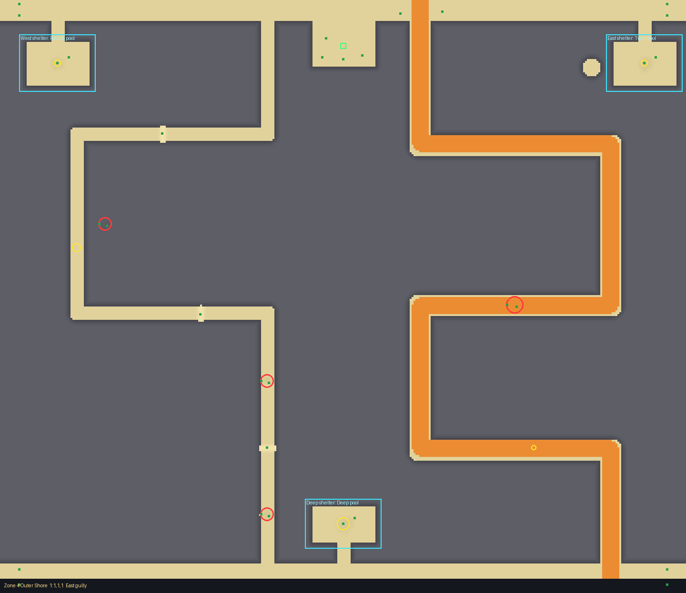
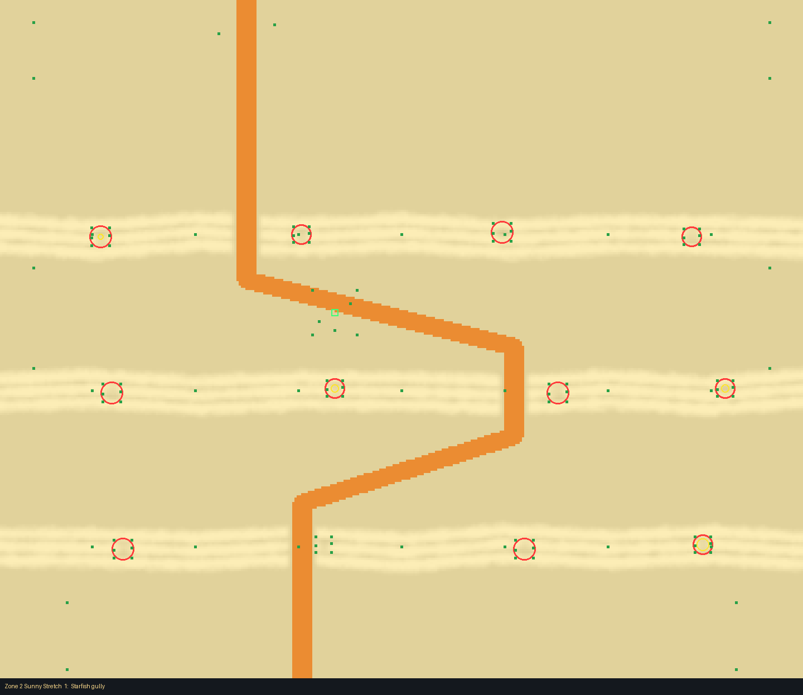

# Tidepool Rocks (planned, common; zones 1 to 4)

Drawn with the layout kit from `tools/kit/plans/tidepool_rocks.py` (edit the plan and run it, not
the layout). It writes `src/shared/Layouts/Biomes/TidepoolRocks.luau`, one layout per
zone. The card is `docs/design/cards/tidepool-rocks.md`. No deadly dangers: the card's question
(a spouting blowhole) is answered gently, so the blowhole is only the entrance's look; the only
hazard is `Slow` wading in the pools.

Check it:  `python3 tools/kit/quick.py <zone> Biomes/TidepoolRocks --plan tools/kit/plans/tidepool_rocks.py`

## Zones 1 to 3: open sand

Sand only: no walls, no rock, nothing above the zone's limit (zone 1: 2.4, zone 2: 4.6, zone 3:
6.4). One wide cart path per crossing (a 16-wide Ramp: a sand gully through the rocks), three
crossings per zone that differ by where the gullies are.

- **The benches** (zones 2 and 3): three flat slate-painted banks across the whole beach, each
  built of three overlapping banks side by side, so the top is broad and level and the two faces
  steep. Pools are dips in their tops (silt-blue, with weed, starfish and urchins at the rim),
  each a `Slow` patch (kept off the cart ramp). A cart winds from gully to gully; on foot you
  climb the benches and wade the pools, which is the shortcut (at least 2 of the 5 test starts
  are quicker on foot in every crossing).
- **Zone 1** may not hide the beach from the top (capped at 20%), so its crossings are two tide
  channels across the beach (3 deep, 14 wide, silt-coloured, with rocks along them), with short
  benches beside them. A cart takes the ramp over each; a walker wades through.
- **The entrance**: a flat spot at a blowhole in the rocks (rocks and barnacles round it), on
  sand between benches.
- **Loot** (Seashell, Starfish, Fishing Lure): in the pools, the best (weight 4) at the sea end.
- **Tells**: a landmark beside each crossing's way in: a starfish, urchins or a drift of shells.
- The beach's own rock pools and the pier are kept clear (benches at z 210 and below in zone 2;
  ramps avoid the pools at (140, 120) in zone 2 and (-60, 130) in zone 3).

| Crossing | Gullies (x, per bench) | Zone 1 cart | Zone 2 cart | Zone 3 cart |
|---|---|---|---|---|
| Starfish gully | west, east, west | 39 s | 46 s | 48 s |
| Urchin gully | east, west, east | 37 s | 47 s | 53 s |
| Shell gully | middle | 35 s | 44 s | 47 s |

On foot every crossing takes 30 s straight down (targets 35, 36, 38 s: 87%, 84%, 80%); a Huge
cart takes the times above, all inside 140% (49, 50 and 53 s). Zone 3's Urchin gully is at the
edge of that (53 of 53.2 s).

## Zone 4: walled slate

Slate walls (12 high, drawn 24 thick) between carved lanes; top and bottom bands across the
whole beach; two crossings, each **2 paths**:

- **The cart gully** (20-wide lane, 16 ramp): three long switchbacks down one half of the beach
  (east in "East gully", west in "West gully"), about 1200 studs, 58 s for a Huge cart, with a
  shallow pool on its middle switchback.
- **The foot way** (12-wide lane) down the other half: two rows, 1000 studs, 48 s. Low rock
  ledges lie across the lane (3 high: a step up, too steep for a cart) and three pools in a row
  slow you, pool to pool.
- **Sheltered pools** off the top and bottom bands, two rooms each: West shelter (Round pool,
  Ledge and lure), East shelter (Twin pool, Overhang: roofed), Deep shelter (Deep pool, Crack and
  pool: the best loot, weight 5, deepest). In the outer columns so every crossing reaches their
  doors through the bands. The east one is clear of the beach's rock pool at (260, 70).
- **The entrance**: a blowhole court off the top band (a small dark dip, rocks, barnacles,
  urchins), flat at (0, 48).
- **Tells**: each crossing's way in has its own marks (starfish and rocks in the east; urchins
  and rocks in the west).

Pictures of zone 4 (crossing 1) and zone 2:

## Checks

- Quick check: no problems, every zone and room.
- `bash tools/check.sh`: all checks passed.
- Test Range (one zone at a time, `--no-routes`): terrain 0.04 to 0.24 studs off on average,
  worst 1.6 to 2.1 under the layout; no floating or buried props of the layout's decor. The
  floating and buried props it lists (up to 48 in zone 2) are all the base zone's own cosmetics
  (`Map.Cosmetics`, `ZoneProps`), placed on the base ground, so they hang or sink a little over
  the channels and pools; they belong to the shore's cosmetics, not this layout.
