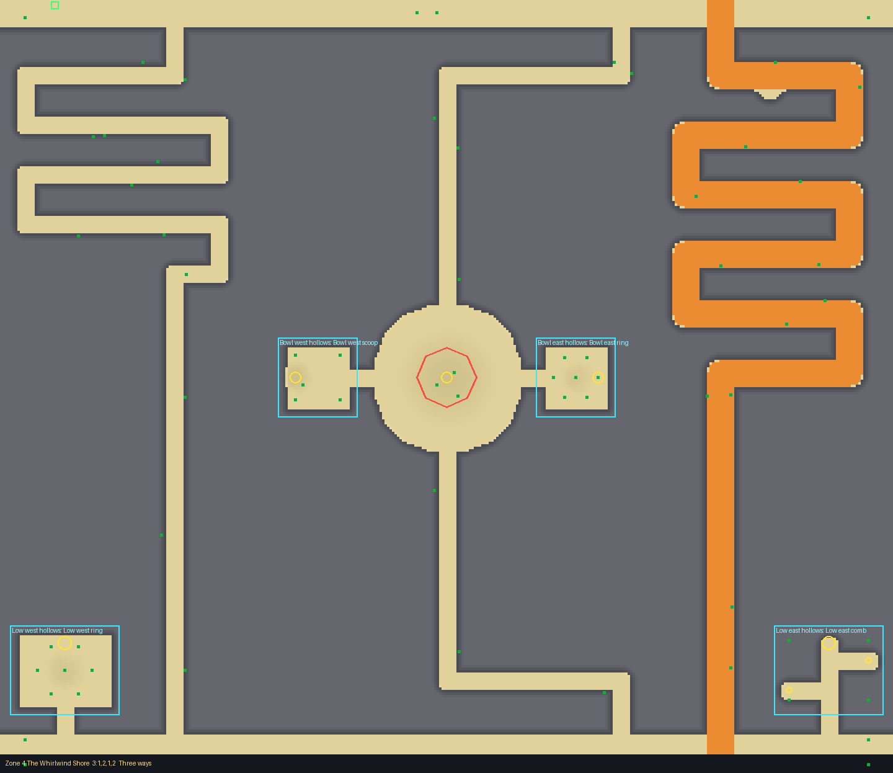
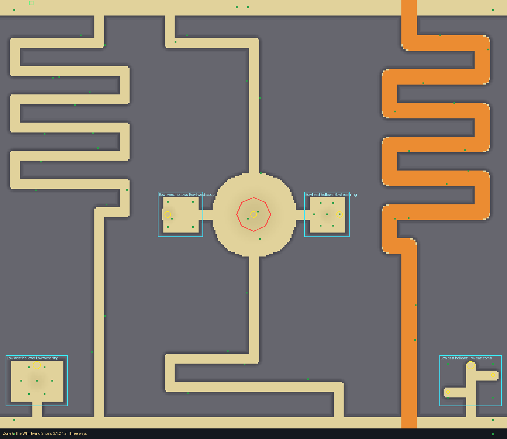
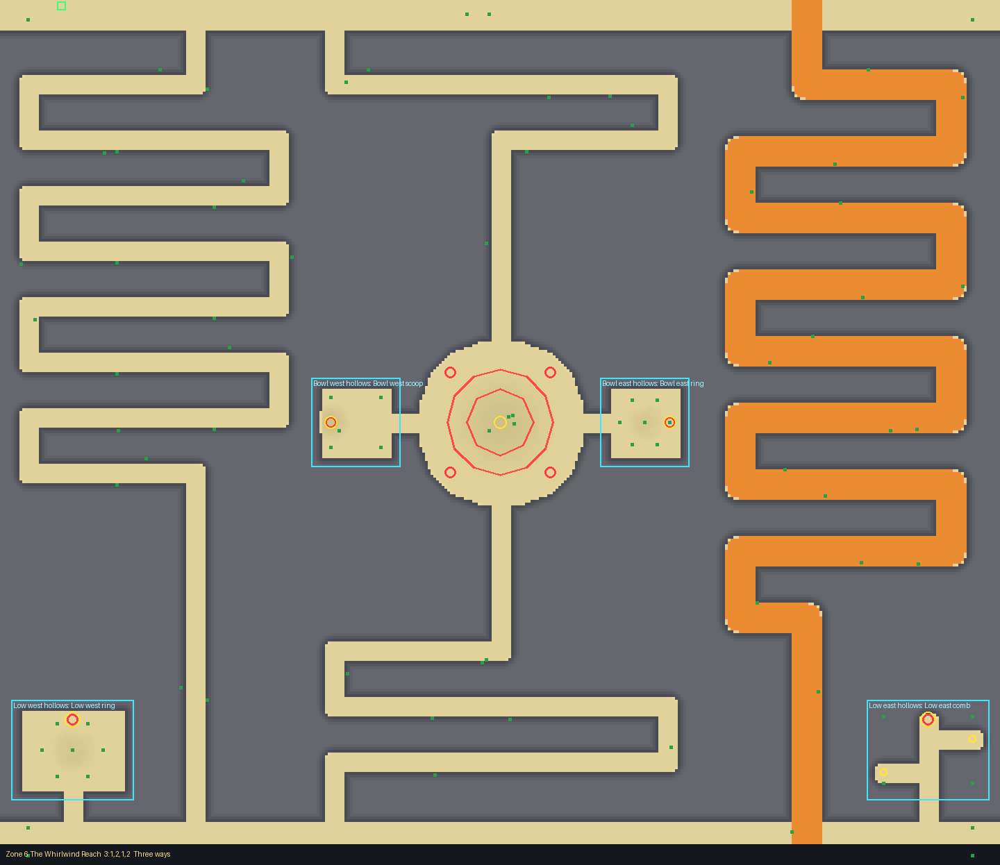

# Whirlwind Dunes (planned biome, zones 4 to 6)

Card: `docs/design/cards/whirlwind-dunes.md`. Drawn with the layout kit from
`tools/kit/plans/whirlwind_dunes.py` (edit the plan and re-run it, never the layout by hand):

    python3 tools/kit/quick.py 5 Biomes/Planned/WhirlwindDunes --plan tools/kit/plans/whirlwind_dunes.py

Each zone is walled (dunes 16 high, packed sand: the `Salt` material, walls drawn 24+ thick) and
has its own layout in `src/shared/Layouts/Biomes/Planned/WhirlwindDunes.luau`.

## The frame (every zone)

- The top and bottom bands, and **the bowl**: a round hall 60 studs in radius at the middle,
  hollowed 3 deep, where **the whirlwind** circles (a loop of radius 24, hit radius 10). Loot at
  its heart.
- **Zone 6 only**: a second, wider whirlwind turning the other way (radius 38), and **four spike
  pits** on the bowl's rim (two open, two under sand), where a fling can throw you; the best
  finds in the rooms sit on covered pits. Zones 4 and 5: the whirlwind flings but nothing is
  waiting (the card's answer).
- Four slots (hollows in the dunes), two rooms each, the best deepest: beside the bowl (west
  and east) and in the bottom corners. Rooms: scoop (a hollow), comb (blind pockets), drift
  (sand heaps), post ring.
- An entrance spot in the top band at (-316, 4).

## The crossings

Every crossing has a bowl path **B** (a narrow foot lane in rows over the dunes, down into the
bowl across the whirlwind's circle, out and down) and one or two **rim** paths (W or E: rows
down the west or east rim). One rim path is the **cart's way**: a 20 wide Ramp, top to bottom.
Tells at the way in: two wind-worn posts (Three ways), an arch of bones (West rim), a heap of
driftwood and pebbles (East rim).

Times from the quick check (feet, seconds; target in brackets):

| Zone | Crossing | Paths (s) |
|---|---|---|
| 4 (55) | West rim | B 42, W ramp 58 |
| 4 | East rim | B 48, E ramp 59 |
| 4 | Three ways | B 42, W 57, E ramp 59 |
| 5 (65) | West rim | B 52, W ramp 68 |
| 5 | East rim | B 57, E ramp 68 |
| 5 | Three ways | B 52, W 59, E ramp 71 |
| 6 (85) | West rim | B 66, W ramp 81 |
| 6 | East rim | B 67, E ramp 77 |
| 6 | Three ways | B 74, W 77, E ramp 89 |

(Pictures show "Three ways": the cart's ramp in orange, the bowl in the middle, the whirlwind
loops and pits in red.)

## Test Range

See the end of this note (filled in after the runs).

Run once per zone with the biome on its tile (`--no-routes`): terrain within 0.03 to 0.06 studs
of the layout on average (worst 2.2), no pits or lanes off the layout. The only buried and
floating things reported are the base zone's own props and cosmetic specks (zone props such as
boulders and columns, coral rubble) that the tile's layout does not own: none of the biome's
decor. The walk's route search (`--no-routes`) was not run.
