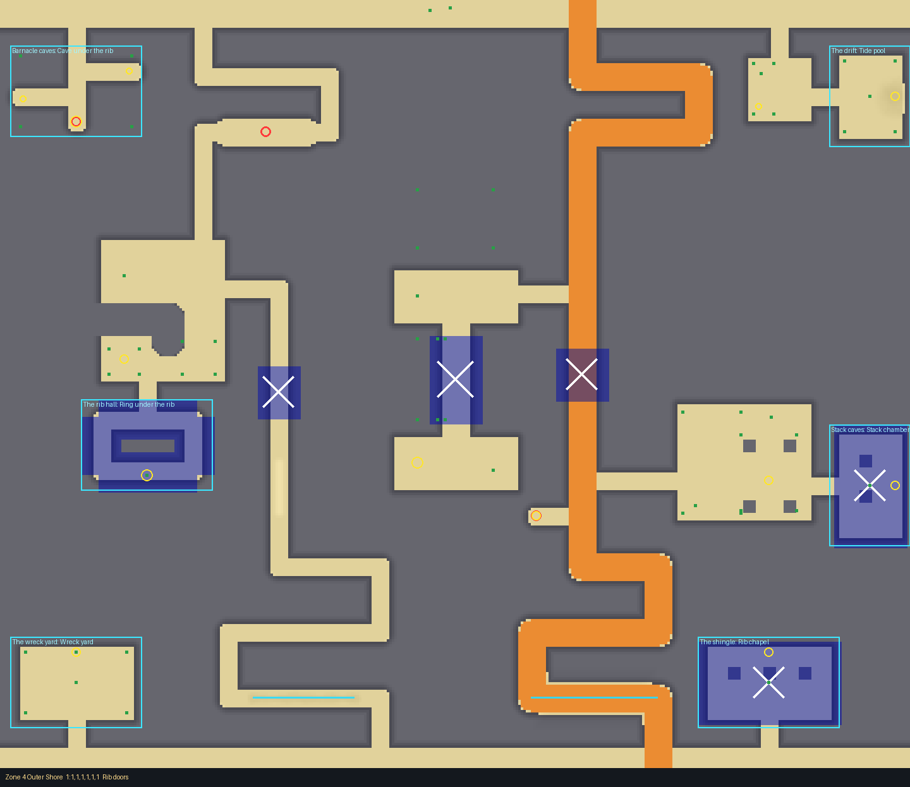
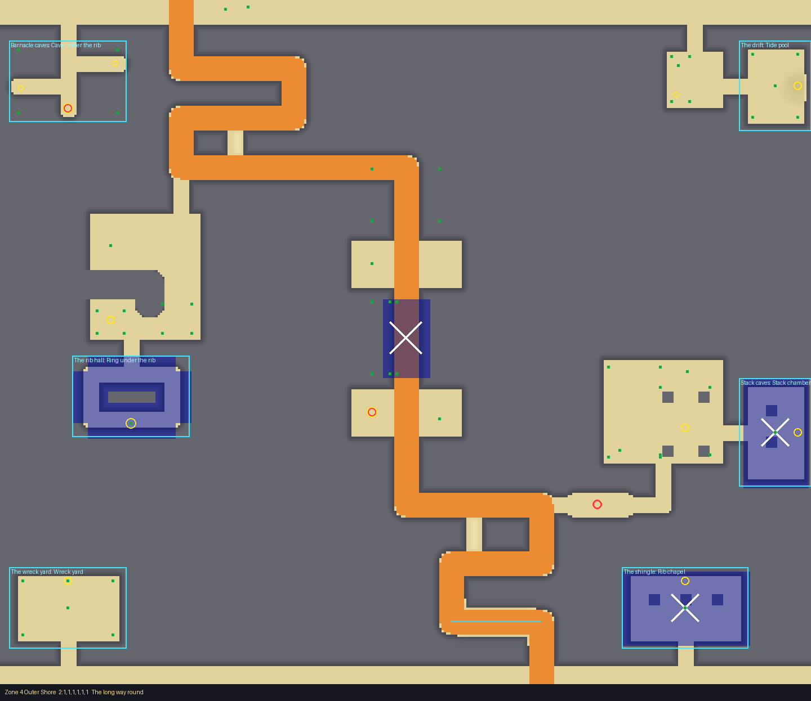
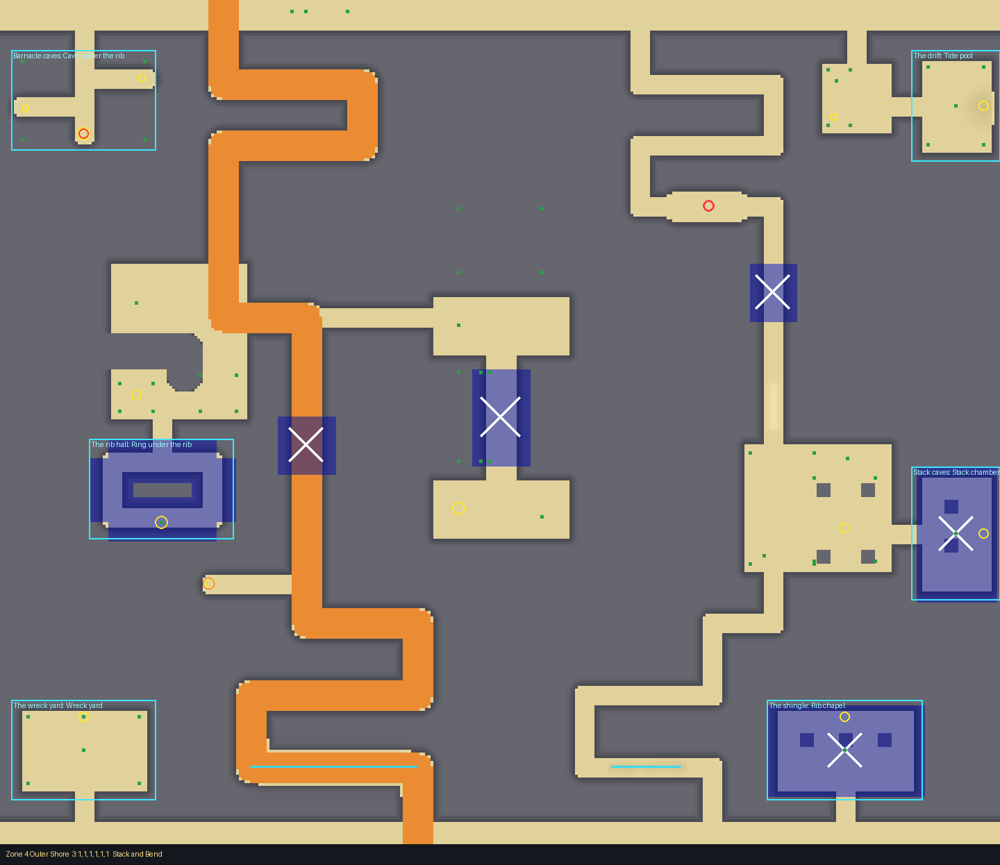
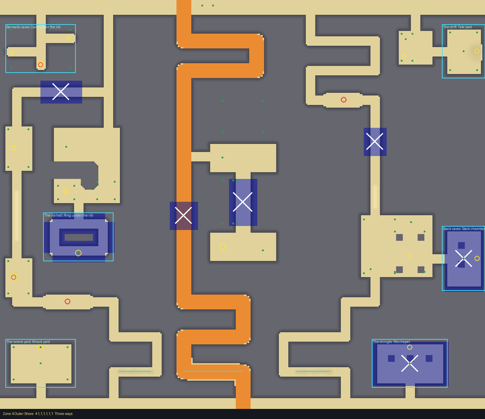
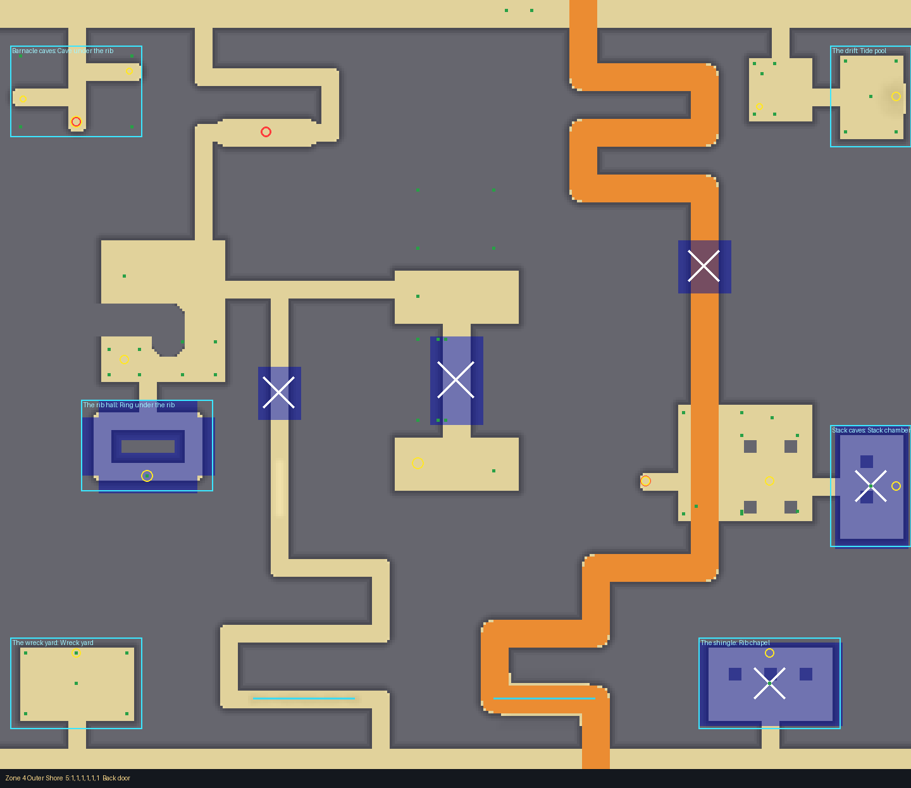

# Zone 4: The Outer Shore

Where the rock starts (its card: `docs/design/cards/zone4.md`). Drawn with the layout kit from
`tools/kit/plans/zone4.py`: edit the plan and re-run it, never `Zone4.luau` by hand.

    python3 tools/kit/quick.py 4 --plan tools/kit/plans/zone4.py

A block of rock 16 high with the zone carved out of it: lanes 12 wide (foot and small carts), the
cart's way a 20 wide ramp (a Huge cart needs 14). Three long ribs of rock run across the beach;
the ways wind round their ends and through their breaks. Walls between carved spaces are drawn at
least 24 thick. Mostly open sky: roofs are the Arch, rock breaks and a few rooms.

## The frame (always there)

- **The bands** across the top (every path starts there) and the bottom (the Far Sandbar's approach).
- **The Arch**: a roofed passage through the middle rib, with a north and a south court and a rockfall in it.
- **The Bend** (west) and **the Stacks** (east): wreck-ribbed and timbered halls the ways turn through.
- **The pool court** round the rock pool at (260, 70), kept clear by 6.
- Six **slots** (barnacle caves, the drift, the rib hall, stack caves, the wreck yard, the shingle),
  two rooms each, the best finds deepest (some on covered pits).

## The five crossings

| # | Name | Paths | Character | Quick check (path s / Huge cart s) |
|---|---|---|---|---|
| 1 | Rib doors | 2 | the cart down the east; a foot way west through the Bend, with a scramble | 45, 54 / 48 |
| 2 | The long way round | 1 | one long way west, across, through the Arch and down the east; two scrambles shortcut it on foot | 46 / 59 |
| 3 | Stack and Bend | 2 | the cart west through the Bend; a foot way east through the Stacks | 50, 51 / 54 |
| 4 | Three ways | 3 | the cart down the middle; the Stacks; the west edge through two coves and a squeeze | 46, 47, 51 / 50 |
| 5 | Back door | 2 | the cart east through the Stacks; a foot way west through the Bend | 48, 54 / 52 |

Every crossing has a Huge cart's way (its cart path) and a tell at the way in: a hull's ribs (1),
an arch of bones (2), an anchor and chain (3), timber and a crate (4), dead coral and a spar (5).
Feet beat carts at the test starts in every crossing (the foot ways and scrambles are shorter).

## Dangers

- **Rockfall** on roofed rock breaks every path must cross (a beat to time; the Arch has one too).
- **Open spike pits**, clearly shown, in a widened break: step round them (crossings 2, 3, 4, 1, 5 on the foot ways).
- **Undertow** in the lowest lane: the cart's way dips into low ground that floods first; the foot
  ways cut a channel that floods when the sea arrives. Safe going down, deadly coming back late.
- **Covered spike pits** under the best finds (the Arch's prize, the cove, deep caves).

## Test Range (every way it comes out)

Clean in every crossing and room choice. The Bend's wall (x -228, z 2081 to 2087 in the Range)
is no longer flagged: its short return is drawn as an area, so the Range does not measure the
corner (35.5) as a wall. The scenery that floated 1 to 2.3 studs in crossings 2 to 4 is fixed in
the game's scenery code: a boulder and its slab, and a coral clump's balls, are one model each,
so GroundShift moves them together; and GroundShift puts away props within 6 studs of a rock
face, or on ground more than half a stud off level, where the terrain sags.
