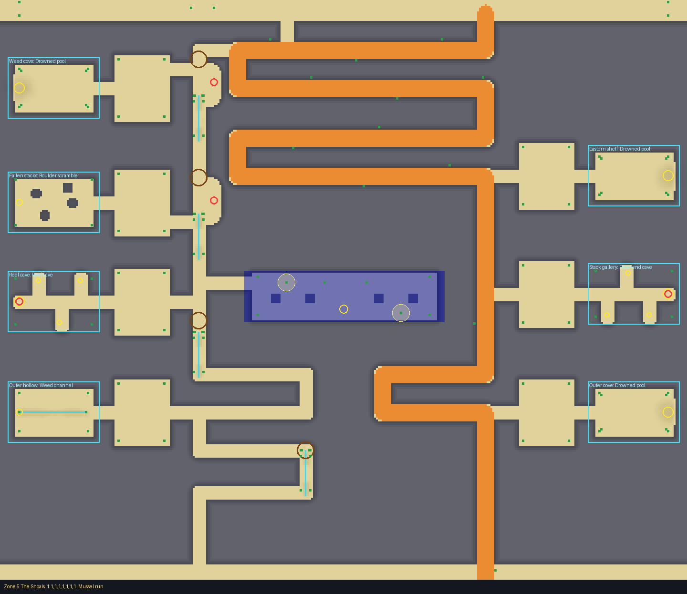
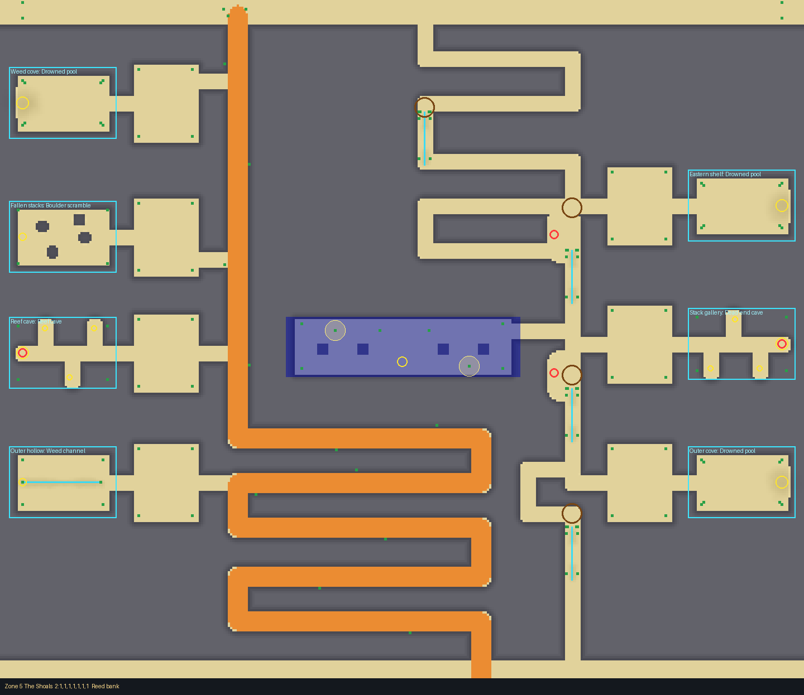
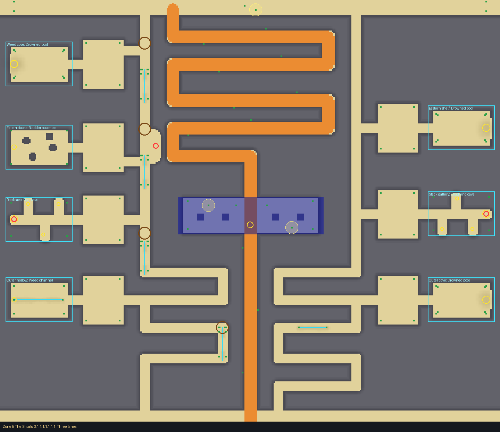
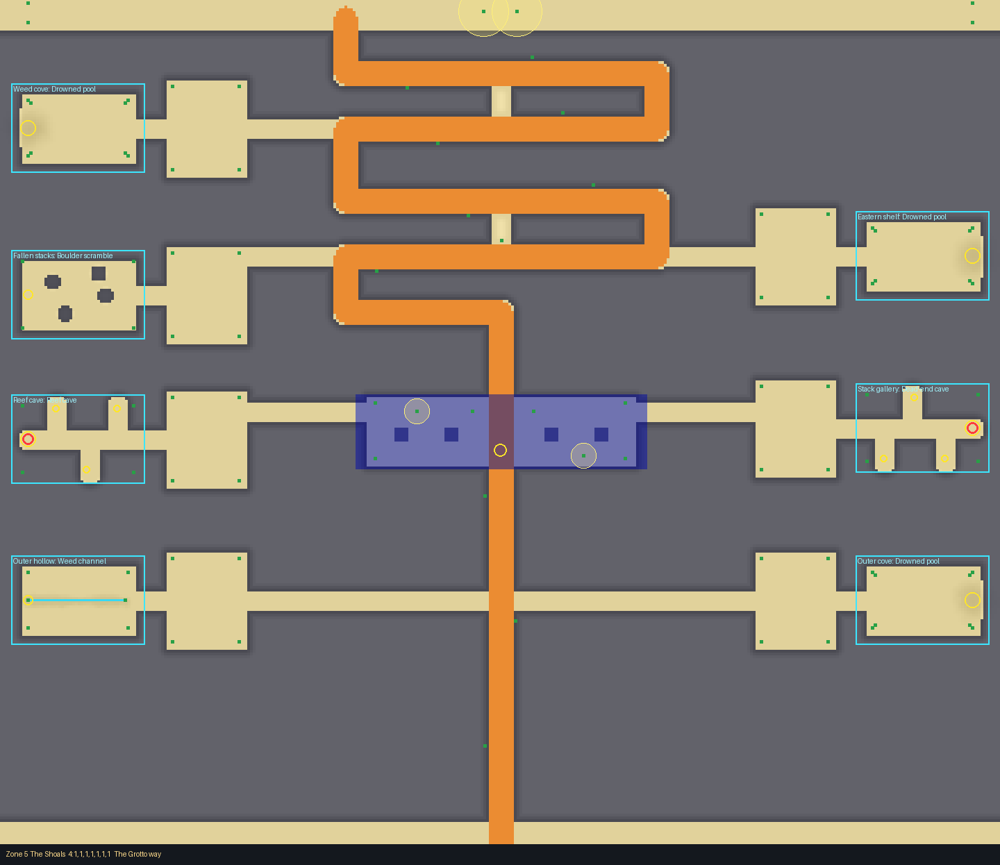
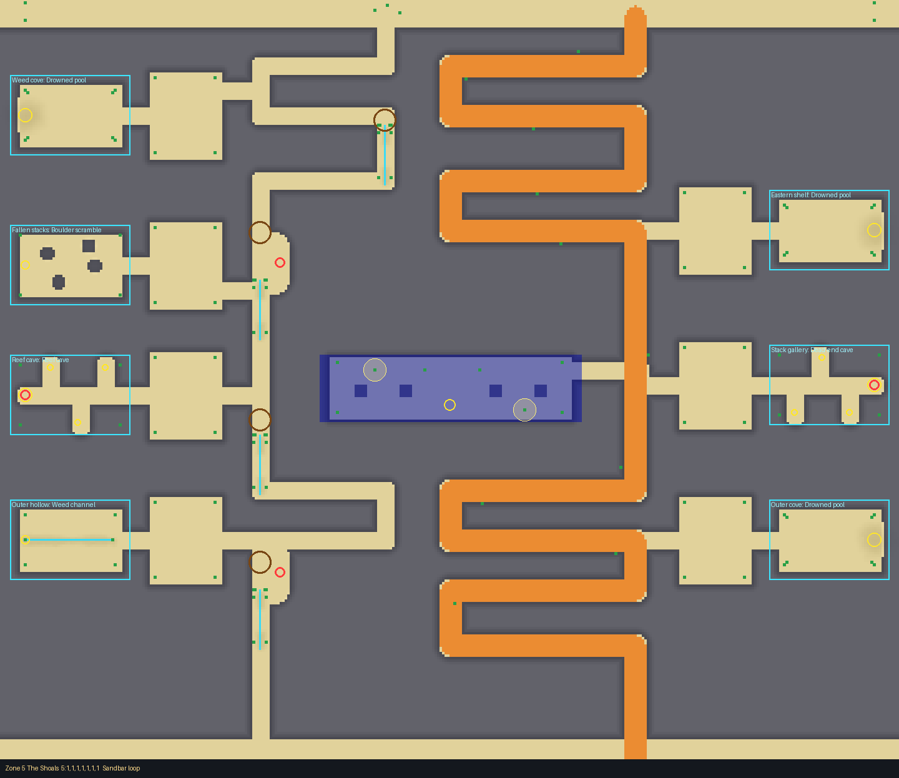

# Zone 5: The Shoals

Flooded ground between four low rock bars: sandbars, fords and runnels, the water always half
in (its card: `docs/design/cards/zone5.md`). Drawn with the layout kit from
`tools/kit/plans/zone5.py`: edit the plan and re-run it, never `Zone5.luau` by hand.

    python3 tools/kit/quick.py 5 --plan tools/kit/plans/zone5.py

A block of rock 14 high (you can't jump or see over it) with the zone carved out of it; walls
between carved spaces are drawn at least 24 thick. Target: 65 s on foot.

## The frame (always there)

- **The bands** across the top (every path starts there) and the bottom (the Far Sandbar's
  approach).
- **Four bars** across the zone at z 124, 248, 372 and 496, 24 thick; the fords are their doors.
- **The Grotto**: a roofed hall on four pillars across the middle (z 286 to 334), the landmark
  and shelter; the one-path crossing runs through it, the others open its west or east door.
- **Seven courts** (open sandbars at x -240 to -184 and 184 to 240) with the slots' doors on
  their outer edges, so every room can be reached whichever crossing rolled.
- Between the second and third bars the only ground is the two gaps beside the Grotto
  (x -152 and 152) and the Grotto itself.

## The five crossings

The wet path is a narrow lane through the fords (foot only: each ford has a sand sill a cart
can't climb); the dry path is the cart's ramp over the sandbars, long and safe.

| # | Name | Paths | Character | Wet (foot) | Dry (Huge cart) |
|---|---|---|---|---|---|
| 1 | Mussel run | 2 | wet down the west gap, dry winding east | 53 s (81%) | 76 s (117%), cart 80 s |
| 2 | Reed bank | 2 | wet runs in the north-east, then the east gap; dry straight down the west | 49 s (76%) | 79 s (121%), cart 82 s |
| 3 | Three lanes | 3 | wet west gap; a dry foot lane down the east gap; the cart's rows then through the Grotto | 49 s (75%), 54 s (83%) | 74 s (115%), cart 78 s |
| 4 | The Grotto way | 1 | everything funnelled through the tunnel; two rubble scrambles cut the rows on foot | 52 s (81%) on foot | cart 78 s |
| 5 | Sandbar loop | 2 | wet along the west edge; dry along the east | 50 s (77%) | 79 s (122%), cart 85 s |

Every crossing has a tell at its way in: fence posts and a net (1), an old anchor and its chain
(2), an arch of bones with glow shells (3), a pair of lanterns (4), urchins and starfish (5).

## Dangers

- **Sinking sand that holds** (`Lethal = false`) across the wet path's approaches to each ford:
  waist deep, slow, no jumping, for as long as you're in it. It never kills; it costs seconds
  going down and is what lets the sea catch you coming back late.
- **Undertow** in every ford and in the runnels (channels 3 deep): deadly once the sea covers
  them, safe going down.
- **Spike pits** (open), well placed: in a widening of the landing before some fords and on the
  lines that cut a corner. A careful player on the lane's middle never meets one.
- No crabs (Hermit Hollows' own).
- Dry path: nothing but distance, and the sea behind you.

## Rooms (7 slots, 2 rooms each)

Drowned pool (the find at its bottom, reachable at low tide), dead-end cave (the best find
deepest, on a covered pit), boulder scramble, weed-choked channel (undertow). Slots: Weed cove,
Fallen stacks, Reef cave, Outer hollow (west); Eastern shelf, Stack gallery, Outer cove (east).

## Decor

Weed mats in the fords and bands, starfish and urchins in the pools and the Grotto, pebbles
along the cart's ramp and on the courts, fence posts and chain nets across each ford, barnacles
in the caves.

## Test Range (every way it comes out)

Clean but for small tolerances: the terrain 2.6 studs off the layout at one wall foot
(crossing 2), and the beach's shared cosmetic textures (glitter sand and salt crust specks a
fraction of a stud under or over the ground, one amphora on the Far Sandbar), which belong to
no layout. Roblox's own pathfinder gives up on the one-path Grotto way from the far east starts
(a long route, as in zone 6); the terrain walk finds the way down from every start (36 to 58 s
from x 280 to -280). Its "fastest way" (32 s) runs along the beach's outer edge strip beyond the
walls, which the walk doesn't bar (the same happens in zone 6); the quick check's path times
above are the measure of the lanes.
