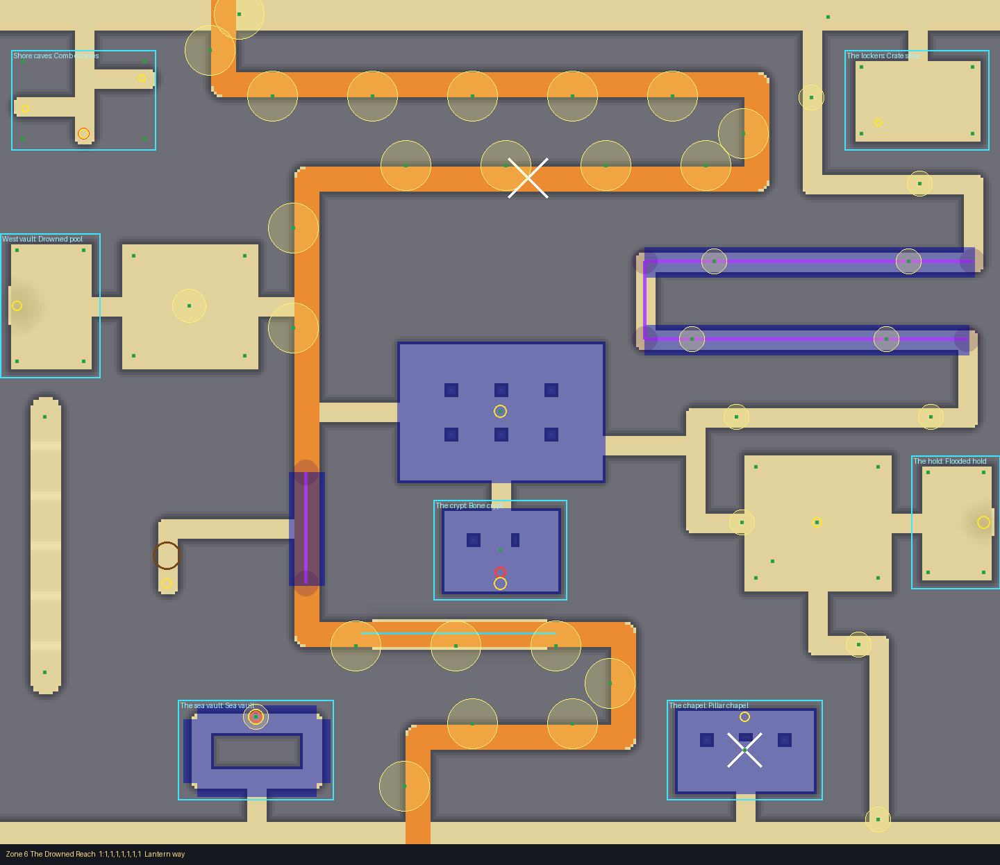
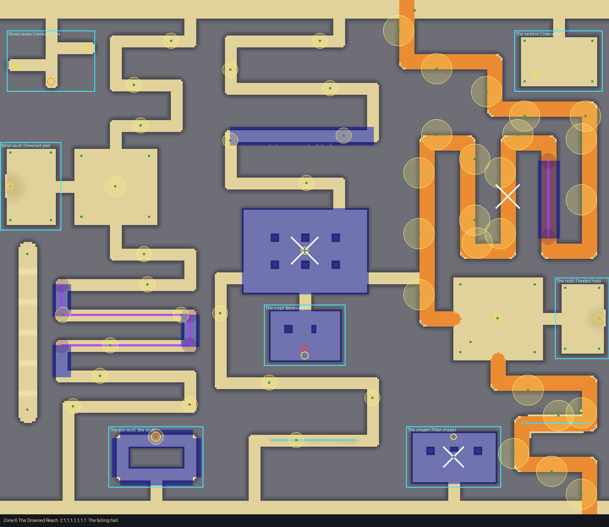
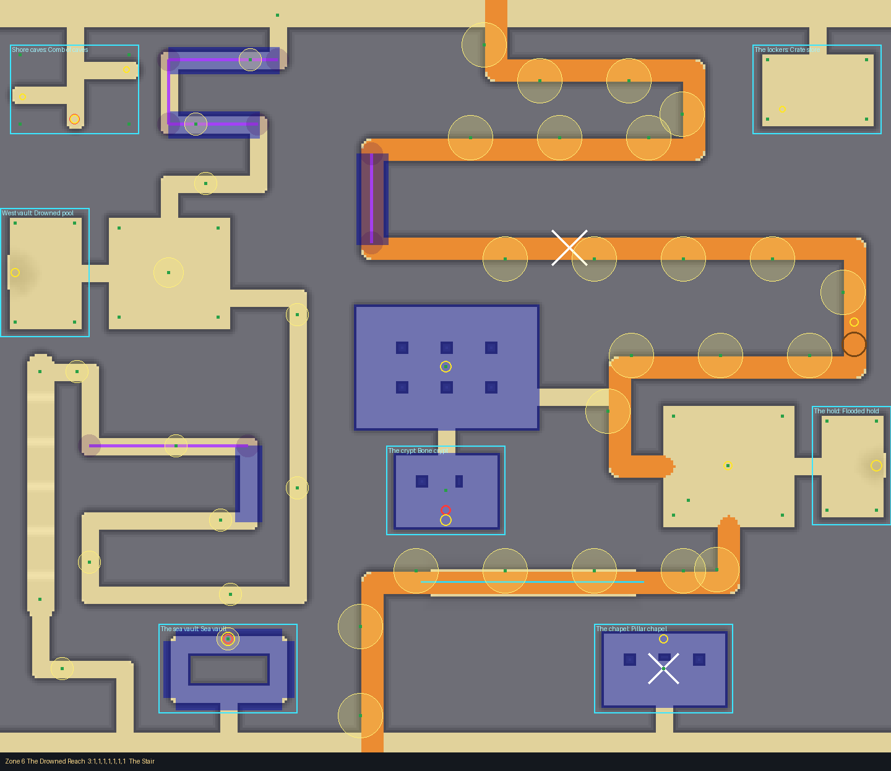
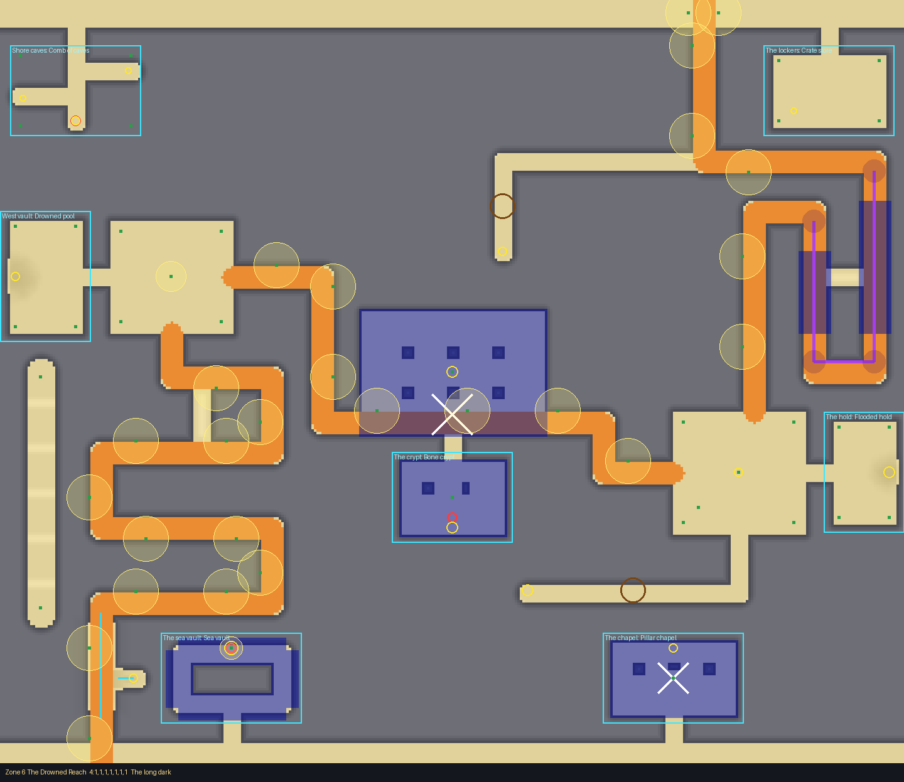
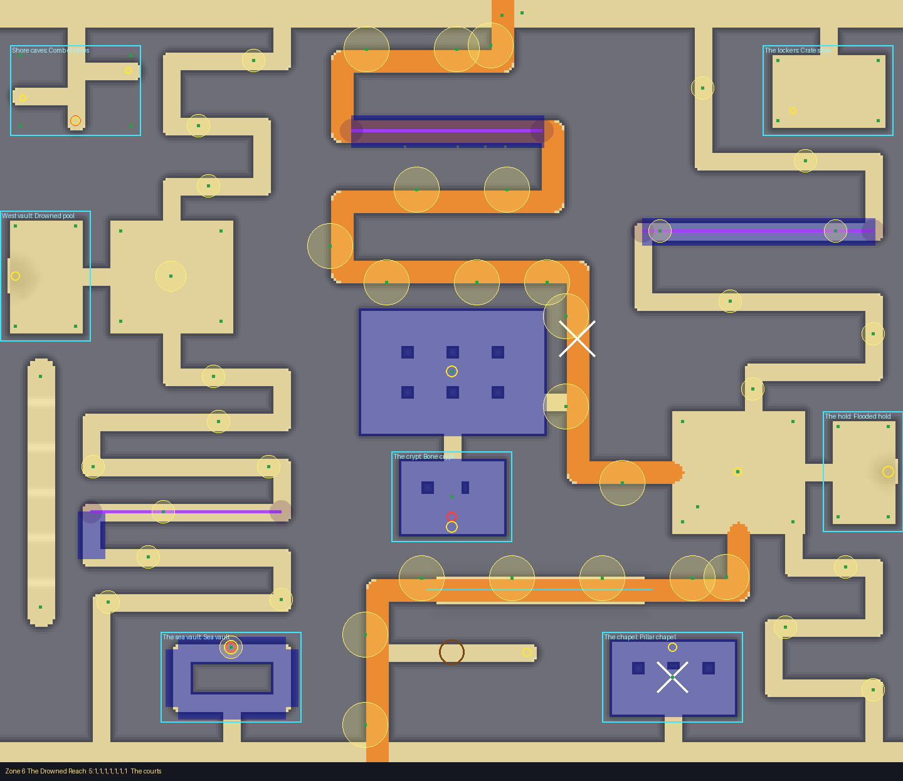

# Zone 6: The Drowned Reach

The deepest, slowest ground on the beach, and **the role model** for every other zone and biome
(its card: `docs/design/cards/zone6.md`). Drawn with the layout kit from
`tools/kit/plans/zone6.py`: edit the plan and re-run it, never `Zone6.luau` by hand.

    python3 tools/kit/quick.py 6 --plan tools/kit/plans/zone6.py

A block of rock 20 high (you can't see or climb over it; invisible barriers cover its tops)
with the zone carved out of it: lanes, galleries, halls, courts and rooms. Walls between carved
spaces are drawn at least 24 thick: the terrain rounds thinner ones into ramps.

## The frame (always there)

- **The bands** across the top (every path starts there) and the bottom (the Far Sandbar's
  approach).
- **The West Court** and **the Wreck Court**: open sky, places to regroup; paths meet there.
- **The Drowned Hall**: a roofed chamber on six pillars in the middle.
- **The Stair**: a gallery down the west side over rubble steps (foot only).
- Seven **slots**, each with its door onto a band, a court or the Hall, so every room can be
  reached whichever crossing rolled.

## The five crossings

| # | Name | Paths | Character | Measured (quick check / engine walk) |
|---|---|---|---|---|
| 1 | Lantern way | 2 | the lit cart path west; a dark serpentine east (the Gloom's) | 69 and 80 s / 66 s |
| 2 | The falling hall | 3 | lit switchbacks east; the dark west rows; through the Hall (rockfall) | 72, 75, 95 s / 68 s |
| 3 | The Stair | 2 | a long lit sweep; the dark west, down past the rows and up them, then the Stair | 82 and 90 s / 77 s |
| 4 | The long dark | 1 | one long way with every danger; two rubble scrambles shortcut it on foot | 90 s / 87 s |
| 5 | The courts | 3 | lit through the centre rows; the dark west; the east rows; two meet at the Wreck Court | 66, 75, 75 s / 62 s |

Every crossing has a Huge cart's way (its lit path, 71 to 110 s) and its own landmark at the
way in: an anchor and lantern (1), a hull's ribs (2), an arch of bones (3), a pair of lanterns
(4), dead coral and a crate (5).

## Dangers

- **The lit path** (lantern posts, the cart's) isn't free: in every crossing it passes a
  **falling roof** (a rhythmic rockfall to time, cart and all), a **dark stretch** with no
  lanterns where the Gloom walks onto it, and **low ground**, a gentle dip that floods first
  with the undertow in it: safe going down, deadly coming back late.
- **The dark galleries**: roofed, lit only by glowing shells; the Gloom walks them.
- **Sinking sand** (deadly) on the lanes to dead-end finds and in the sinking-flat rooms.
- **Covered spike pits** under the best finds (the cracks round them are the tell).
- **The tide**: the whole Reach floods first; the long ways are what catch the late.

## Rooms

Comb of caves, flooded vault, sinking flat, tunnel ring, pillared chamber, boulder scramble:
two or three kinds per slot. The best finds (the sea vault, the crypt) are deepest, on covered
pits.

## Test Range (every way it comes out)

Clean but for small tolerances: the terrain 2.5 to 3 studs off the layout at a few wall feet,
a sinking-sand patch or a stone of rubble a fraction of a stud off the ground. Roblox's own
pathfinder gives up on the longest routes (about 75 s and over); the terrain walk, the measure
that counts, finds the way down from every start.
